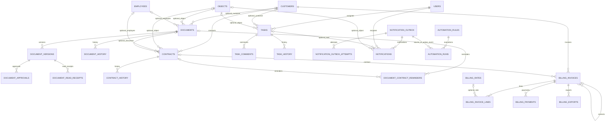

# Datenbankschema

## Stand und Quellen

Diese Referenz beschreibt den auf `main` zusammengeführten Stand `eb4d4ca3e75f8281af9bf2a5ccd48f0bcace3e60` vom 09.11.2026. Die lineare Alembic-Kette reicht von `0001_customers` bis `0035_worker_monitoring`; `0035_worker_monitoring` ist der aktuelle Kopf. Grundlage sind [`backend/app/models.py`](../backend/app/models.py) und alle Dateien in [`backend/migrations/versions/`](../backend/migrations/versions/).

Das ORM-Modell deklariert 89 Tabellen. Migration `0029_audit_integrity` ergänzt `audit_log_integrity` direkt in PostgreSQL und ohne ORM-Modell: insgesamt also 90 Schema-Tabellen. Die FK-Übersicht nennt für sämtliche Tabellen die Primärschlüssel sowie alle Fremdschlüssel mit ihren Löschregeln. Nicht-Schlüsselspalten und konkrete Constraint-Ausdrücke stehen in Modell bzw. Migration; die folgenden Abschnitte heben die wesentlichen Datenbankregeln und Grenzen hervor.

PostgreSQL ist die Migrations- und Betriebsdatenbank. UUIDs werden als UUID, zeitzonenbewusste Zeitpunkte als `TIMESTAMPTZ`, `Numeric`-Werte als `NUMERIC` und `LargeBinary`-Werte als `BYTEA` abgebildet. JSON-Spalten sind PostgreSQL-`JSON`. Die Diagramm-Beziehungen entsprechen echten Fremdschlüsseln; fachliche Zuordnungen ohne FK werden nicht als FK dargestellt.

## Tabellen, Primär- und Fremdschlüssel

`PK` bezeichnet den Primärschlüssel. Fremdschlüssel sind als `Spalte → Tabelle.Spalte (ON DELETE)` notiert. `SET NULL`-Fremdschlüssel sind nullable; `CASCADE` gilt nur für die hier gezeigten referenzierten Zeilen. Tabellen ohne Fremdschlüssel sind mit `—` markiert.

| Fachbereich | Tabelle | PK | Fremdschlüssel |
|---|---|---|---|
| Identität/Audit | `users` | `id` | — |
| Identität/Audit | `roles` | `id` | — |
| Identität/Audit | `permissions` | `id` | — |
| Identität/Audit | `user_roles` | (`user_id`, `role_id`) | `user_id` → `users.id` (CASCADE); `role_id` → `roles.id` (CASCADE) |
| Identität/Audit | `role_permissions` | (`role_id`, `permission_id`) | `role_id` → `roles.id` (CASCADE); `permission_id` → `permissions.id` (CASCADE) |
| Identität/Audit | `user_sessions` | `id` | `user_id` → `users.id` (CASCADE) |
| Identität/Audit | `user_mfa_recovery_codes` | `id` | `user_id` → `users.id` (CASCADE) |
| Identität/Audit | `audit_logs` | `id` | — (`actor_id` ist absichtlich kein FK) |
| Identität/Audit | `audit_log_integrity` | `audit_log_id` | `audit_log_id` → `audit_logs.id` (RESTRICT; zugleich PK) |
| Kunden/Objekte | `customers` | `id` | — |
| Kunden/Objekte | `customer_addresses` | `id` | `customer_id` → `customers.id` (RESTRICT) |
| Kunden/Objekte | `customer_contacts` | `id` | `customer_id` → `customers.id` (RESTRICT) |
| Kunden/Objekte | `customer_history` | `id` | `customer_id` → `customers.id` (RESTRICT); `actor_id` → `users.id` (SET NULL) |
| Kunden/Objekte | `objects` | `id` | `customer_id` → `customers.id` (RESTRICT) |
| Kunden/Objekte | `object_addresses` | `id` | `object_id` → `objects.id` (RESTRICT) |
| Kunden/Objekte | `object_contacts` | `id` | `object_id` → `objects.id` (RESTRICT) |
| Kunden/Objekte | `object_history` | `id` | `object_id` → `objects.id` (RESTRICT); `actor_id` → `users.id` (SET NULL) |
| Kunden/Objekte | `object_assignments` | `id` | `object_id` → `objects.id` (RESTRICT); `user_id` → `users.id` (RESTRICT); `assigned_by_id` → `users.id` (SET NULL) |
| Kunden/Objekte | `object_security_details` | `object_id` | `object_id` → `objects.id` (RESTRICT; zugleich PK) |
| Kundenportal | `customer_portal_links` | `id` | `user_id` → `users.id` (RESTRICT); `contact_id` → `customer_contacts.id` (RESTRICT); `created_by_id` → `users.id` (SET NULL) |
| Kundenportal | `customer_portal_link_history` | `id` | `user_id` → `users.id` (RESTRICT); `contact_id` → `customer_contacts.id` (RESTRICT); `actor_id` → `users.id` (SET NULL) |
| Kundenportal | `customer_portal_document_grants` | `id` | `document_id` → `documents.id` (RESTRICT); `version_id` → `document_versions.id` (RESTRICT); `customer_id` → `customers.id` (RESTRICT); `granted_by_id`, `revoked_by_id` → `users.id` (SET NULL) |
| Kundenportal | `customer_portal_document_grant_history` | `id` | `grant_id` → `customer_portal_document_grants.id` (RESTRICT); `actor_id` → `users.id` (SET NULL) |
| Kundenportal | `customer_portal_requests` | `id` | `customer_id` → `customers.id` (RESTRICT); `contact_id` → `customer_contacts.id` (RESTRICT); `object_id` → `objects.id` (RESTRICT) |
| Kundenportal | `customer_portal_request_messages` | `id` | `request_id` → `customer_portal_requests.id` (RESTRICT); `author_id` → `users.id` (SET NULL) |
| Kundenportal | `customer_portal_request_attachments` | `id` | `request_id` → `customer_portal_requests.id` (RESTRICT); `uploaded_by_id` → `users.id` (SET NULL) |
| Kundenportal | `customer_portal_request_history` | `id` | `request_id` → `customer_portal_requests.id` (RESTRICT); `actor_id` → `users.id` (SET NULL) |
| Personal/Qualifikation | `employees` | `id` | `user_id` → `users.id` (SET NULL; UNIQUE) |
| Personal/Qualifikation | `employee_qualifications` | `id` | `employee_id` → `employees.id` (RESTRICT) |
| Personal/Qualifikation | `employee_qualification_documents` | `id` | `qualification_id` → `employee_qualifications.id` (RESTRICT); `uploaded_by_id` → `users.id` (SET NULL) |
| Personal/Qualifikation | `employee_absences` | `id` | `employee_id` → `employees.id` (RESTRICT); `created_by_id` → `users.id` (SET NULL) |
| Personal/Qualifikation | `employee_sensitive_details` | `employee_id` | `employee_id` → `employees.id` (RESTRICT; zugleich PK) |
| Personal/Qualifikation | `employee_history` | `id` | `employee_id` → `employees.id` (RESTRICT); `actor_id` → `users.id` (SET NULL) |
| Personal/Qualifikation | `employee_object_assignment_history` | `id` | `employee_id` → `employees.id` (RESTRICT); `object_id` → `objects.id` (RESTRICT); `user_id`, `actor_id` → `users.id` (SET NULL) |
| Personal/Planung | `employee_availability_windows` | `id` | `employee_id` → `employees.id` (RESTRICT); `created_by_id` → `users.id` (SET NULL) |
| Personal/Planung | `schedule_availability_requests` | `id` | `employee_id` → `employees.id` (RESTRICT); `created_by_id`, `reviewed_by_id` → `users.id` (SET NULL) |
| Mitarbeiterportal | `employee_portal_document_grants` | `id` | `employee_id` → `employees.id` (RESTRICT); `user_id` → `users.id` (RESTRICT); `qualification_document_id` → `employee_qualification_documents.id` (RESTRICT); `granted_by_id` → `users.id` (SET NULL); `revoked_by_id` → `users.id` (RESTRICT) |
| Mitarbeiterportal | `employee_portal_document_grant_history` | `id` | `grant_id` → `employee_portal_document_grants.id` (RESTRICT); `actor_id` → `users.id` (SET NULL) |
| Dienstplanung | `schedule_settings` | `id` | `updated_by_id` → `users.id` (SET NULL) |
| Zeiterfassung | `schedule_shifts` | `id` | `employee_id` → `employees.id` (RESTRICT); `object_id` → `objects.id` (RESTRICT); `created_by_id` → `users.id` (SET NULL) |
| Zeiterfassung | `schedule_shift_history` | `id` | `shift_id` → `schedule_shifts.id` (RESTRICT); `actor_id` → `users.id` (SET NULL) |
| Zeiterfassung | `time_entries` | `id` | `employee_id` → `employees.id` (RESTRICT); `object_id` → `objects.id` (RESTRICT); `shift_id` → `schedule_shifts.id` (RESTRICT); `created_by_id`, `reviewed_by_id` → `users.id` (SET NULL) |
| Zeiterfassung | `time_entry_segments` | `id` | `entry_id` → `time_entries.id` (RESTRICT) |
| Zeiterfassung | `time_entry_corrections` | `id` | `entry_id` → `time_entries.id` (RESTRICT); `requested_by_id`, `decided_by_id` → `users.id` (SET NULL) |
| Zeiterfassung | `time_entry_correction_segments` | `id` | `correction_id` → `time_entry_corrections.id` (RESTRICT) |
| Zeiterfassung | `time_entry_history` | `id` | `entry_id` → `time_entries.id` (RESTRICT); `actor_id` → `users.id` (SET NULL) |
| Zeiterfassung | `time_tracking_settings` | `id` | `updated_by_id` → `users.id` (SET NULL) |
| Zeiterfassung | `time_surcharge_rules` | `id` | `created_by_id` → `users.id` (SET NULL) |
| Zeiterfassung | `time_surcharge_calculations` | `id` | `entry_id` → `time_entries.id` (RESTRICT); `created_by_id` → `users.id` (SET NULL) |
| Zeiterfassung | `time_tracking_periods` | `id` | `locked_by_id` → `users.id` (SET NULL) |
| OWKS | `owks_control_points` | `id` | `object_id` → `objects.id` (RESTRICT); `created_by_id` → `users.id` (SET NULL) |
| OWKS | `owks_routes` | `id` | `object_id` → `objects.id` (RESTRICT); `created_by_id` → `users.id` (SET NULL) |
| OWKS | `owks_route_points` | `id` | `route_id` → `owks_routes.id` (RESTRICT); `control_point_id` → `owks_control_points.id` (RESTRICT) |
| OWKS | `owks_challenges` | `id` | `object_id` → `objects.id` (RESTRICT); `user_id` → `users.id` (RESTRICT) |
| OWKS | `owks_events` | `id` | `object_id` → `objects.id` (RESTRICT); `route_id` → `owks_routes.id` (RESTRICT); `control_point_id` → `owks_control_points.id` (RESTRICT); `corrects_event_id` → `owks_events.id` (RESTRICT); `employee_id` → `employees.id` (RESTRICT); `actor_id` → `users.id` (RESTRICT); `challenge_id` → `owks_challenges.id` (RESTRICT) |
| OWKS | `owks_event_statuses` | `id` | `event_id` → `owks_events.id` (RESTRICT); `actor_id` → `users.id` (RESTRICT) |
| OWKS | `owks_attachments` | `id` | `event_id` → `owks_events.id` (RESTRICT); `uploaded_by_id` → `users.id` (RESTRICT) |
| Vorfälle | `incidents` | `id` | `object_id` → `objects.id` (RESTRICT); `assigned_to_id` → `users.id` (RESTRICT); `owks_event_id` → `owks_events.id` (RESTRICT); `created_by_id` → `users.id` (SET NULL) |
| Vorfälle | `incident_sensitive_details` | `incident_id` | `incident_id` → `incidents.id` (RESTRICT; zugleich PK); `updated_by_id` → `users.id` (SET NULL) |
| Vorfälle | `incident_measures` | `id` | `incident_id` → `incidents.id` (RESTRICT); `assigned_to_id` → `users.id` (RESTRICT); `created_by_id` → `users.id` (SET NULL) |
| Vorfälle | `incident_people` | `id` | `incident_id` → `incidents.id` (RESTRICT); `created_by_id` → `users.id` (RESTRICT) |
| Vorfälle | `incident_attachments` | `id` | `incident_id` → `incidents.id` (RESTRICT); `uploaded_by_id` → `users.id` (RESTRICT) |
| Vorfälle | `incident_history` | `id` | `incident_id` → `incidents.id` (RESTRICT); `actor_id` → `users.id` (RESTRICT) |
| Dokumente/Verträge | `documents` | `id` | `customer_id` → `customers.id` (RESTRICT); `object_id` → `objects.id` (RESTRICT); `employee_id` → `employees.id` (RESTRICT); `created_by_id` → `users.id` (SET NULL) |
| Dokumente/Verträge | `document_versions` | `id` | `document_id` → `documents.id` (RESTRICT); `uploaded_by_id` → `users.id` (SET NULL) |
| Dokumente/Verträge | `document_approvals` | `id` | `version_id` → `document_versions.id` (RESTRICT); `requested_by_id`, `decided_by_id` → `users.id` (SET NULL) |
| Dokumente/Verträge | `document_read_receipts` | `id` | `version_id` → `document_versions.id` (RESTRICT); `user_id` → `users.id` (RESTRICT) |
| Dokumente/Verträge | `document_history` | `id` | `document_id` → `documents.id` (RESTRICT); `actor_id` → `users.id` (SET NULL) |
| Dokumente/Verträge | `contracts` | `id` | `customer_id` → `customers.id` (RESTRICT); `object_id` → `objects.id` (RESTRICT); `employee_id` → `employees.id` (RESTRICT); `document_id` → `documents.id` (SET NULL); `created_by_id` → `users.id` (SET NULL) |
| Dokumente/Verträge | `contract_history` | `id` | `contract_id` → `contracts.id` (RESTRICT); `actor_id` → `users.id` (SET NULL) |
| Dokumente/Verträge | `document_contract_reminder_settings` | `id` | `updated_by_id` → `users.id` (SET NULL) |
| Dokumente/Verträge | `document_contract_reminders` | `id` | `document_id` → `documents.id` (RESTRICT); `contract_id` → `contracts.id` (RESTRICT) |
| Abrechnung | `billing_rates` | `id` | `created_by_id` → `users.id` (SET NULL) |
| Abrechnung | `billing_invoices` | `id` | `customer_id` → `customers.id` (RESTRICT); `contract_id` → `contracts.id` (RESTRICT); `correction_of_id` → `billing_invoices.id` (RESTRICT); `created_by_id`, `approved_by_id` → `users.id` (SET NULL) |
| Abrechnung | `billing_invoice_lines` | `id` | `invoice_id` → `billing_invoices.id` (RESTRICT); `rate_id` → `billing_rates.id` (SET NULL) |
| Abrechnung | `billing_payments` | `id` | `invoice_id` → `billing_invoices.id` (RESTRICT); `created_by_id` → `users.id` (SET NULL) |
| Abrechnung | `billing_exports` | `id` | `invoice_id` → `billing_invoices.id` (RESTRICT); `created_by_id` → `users.id` (SET NULL) |
| Aufgaben/Benachrichtigungen | `tasks` | `id` | `assigned_to_id` → `users.id` (RESTRICT); `created_by_id` → `users.id` (SET NULL); `customer_id` → `customers.id` (RESTRICT); `object_id` → `objects.id` (RESTRICT) |
| Aufgaben/Benachrichtigungen | `task_comments` | `id` | `task_id` → `tasks.id` (CASCADE); `author_id` → `users.id` (SET NULL) |
| Aufgaben/Benachrichtigungen | `task_history` | `id` | `task_id` → `tasks.id` (CASCADE); `actor_id` → `users.id` (SET NULL) |
| Aufgaben/Benachrichtigungen | `notification_outbox` | `id` | — (`aggregate_type`/`aggregate_id` bilden keinen FK) |
| Aufgaben/Benachrichtigungen | `notification_outbox_attempts` | `id` | `outbox_id` → `notification_outbox.id` (RESTRICT) |
| Aufgaben/Benachrichtigungen | `notification_worker_heartbeats` | `worker_name` | — |
| Aufgaben/Benachrichtigungen | `notifications` | `id` | `outbox_id` → `notification_outbox.id` (RESTRICT); `recipient_id` → `users.id` (CASCADE); `task_id` → `tasks.id` (RESTRICT); `object_id` → `objects.id` (RESTRICT) |
| Automatisierungen | `automation_rules` | `id` | `created_by_id`, `updated_by_id` → `users.id` (SET NULL) |
| Automatisierungen | `automation_runs` | `id` | `rule_id` → `automation_rules.id` (RESTRICT); `source_event_id`, `action_event_id` → `notification_outbox.id` (RESTRICT) |
| Inventar/Schlüssel | `physical_keys` | `id` | `object_id` → `objects.id` (RESTRICT); `current_employee_id` → `employees.id` (RESTRICT); `created_by_id` → `users.id` (SET NULL) |
| Inventar/Schlüssel | `key_movements` | `id` | `key_id` → `physical_keys.id` (RESTRICT); `object_id` → `objects.id` (RESTRICT); `employee_id` → `employees.id` (RESTRICT); `actor_id` → `users.id` (RESTRICT) |
| Inventar/Schlüssel | `inventory_assets` | `id` | `object_id` → `objects.id` (RESTRICT); `current_employee_id` → `employees.id` (RESTRICT); `created_by_id` → `users.id` (SET NULL) |
| Inventar/Schlüssel | `inventory_events` | `id` | `asset_id` → `inventory_assets.id` (RESTRICT); `object_id`, `from_object_id`, `to_object_id` → `objects.id` (RESTRICT); `from_employee_id`, `to_employee_id` → `employees.id` (RESTRICT); `actor_id` → `users.id` (RESTRICT) |

`user_id` in `employees` ist nullable und UNIQUE; damit kann ein Benutzer höchstens einem Personalstammsatz zugeordnet sein. Die einspaltigen PK/FK-Tabellen `object_security_details`, `employee_sensitive_details` und `incident_sensitive_details` bilden optionale 1:1-Erweiterungen. `schedule_settings`, `time_tracking_settings` und `document_contract_reminder_settings` begrenzen ihre Singleton-Zeile über `CHECK (id = 1)`.

## Beziehungsdiagramm

Die Diagramme zeigen fachliche FK-Beziehungen mit ihrer optionalen bzw. verpflichtenden Seite. FK-Verweise auf `users` für Ersteller, Prüfer und Akteure sind aus Lesbarkeitsgründen nicht überall gezeichnet; sie stehen vollständig im Tabellenkatalog. Linien bezeichnen keine zusätzlichen Geschäftsregeln über die genannten Fremdschlüssel hinaus.

```mermaid
erDiagram
    CUSTOMERS ||--o{ CUSTOMER_ADDRESSES : addresses
    CUSTOMERS ||--o{ CUSTOMER_CONTACTS : contacts
    CUSTOMERS ||--o{ CUSTOMER_HISTORY : history
    CUSTOMERS ||--o{ OBJECTS : owns
    OBJECTS ||--o| OBJECT_ADDRESSES : address
    OBJECTS ||--o{ OBJECT_CONTACTS : contacts
    OBJECTS ||--o{ OBJECT_HISTORY : history
    OBJECTS ||--o{ OBJECT_ASSIGNMENTS : access_assignments
    USERS ||--o{ OBJECT_ASSIGNMENTS : assigned_user
    OBJECTS ||--o| OBJECT_SECURITY_DETAILS : restricted_details
    USERS ||--o{ USER_SESSIONS : sessions
    USERS ||--o{ USER_MFA_RECOVERY_CODES : recovery_codes
    USERS ||--o{ USER_ROLES : memberships
    ROLES ||--o{ USER_ROLES : memberships
    ROLES ||--o{ ROLE_PERMISSIONS : grants
    PERMISSIONS ||--o{ ROLE_PERMISSIONS : granted
    AUDIT_LOGS ||--|| AUDIT_LOG_INTEGRITY : integrity
    USERS o|--o| EMPLOYEES : account
    EMPLOYEES ||--o{ EMPLOYEE_QUALIFICATIONS : qualifications
    EMPLOYEE_QUALIFICATIONS ||--o{ EMPLOYEE_QUALIFICATION_DOCUMENTS : evidence_versions
    EMPLOYEES ||--o| EMPLOYEE_SENSITIVE_DETAILS : restricted_details
    EMPLOYEES ||--o{ EMPLOYEE_ABSENCES : absences
    EMPLOYEES ||--o{ EMPLOYEE_OBJECT_ASSIGNMENT_HISTORY : assignment_history
    OBJECTS ||--o{ EMPLOYEE_OBJECT_ASSIGNMENT_HISTORY : assignment_history
    USERS ||--o| CUSTOMER_PORTAL_LINKS : login
    CUSTOMER_CONTACTS ||--o| CUSTOMER_PORTAL_LINKS : contact
    USERS ||--o{ CUSTOMER_PORTAL_LINK_HISTORY : user
    CUSTOMER_CONTACTS ||--o{ CUSTOMER_PORTAL_LINK_HISTORY : contact
    CUSTOMERS ||--o{ CUSTOMER_PORTAL_REQUESTS : requests
    CUSTOMER_CONTACTS ||--o{ CUSTOMER_PORTAL_REQUESTS : submitted_by
    OBJECTS ||--o{ CUSTOMER_PORTAL_REQUESTS : about_object
    CUSTOMER_PORTAL_REQUESTS ||--o{ CUSTOMER_PORTAL_REQUEST_MESSAGES : messages
    CUSTOMER_PORTAL_REQUESTS ||--o{ CUSTOMER_PORTAL_REQUEST_ATTACHMENTS : attachments
    CUSTOMER_PORTAL_REQUESTS ||--o{ CUSTOMER_PORTAL_REQUEST_HISTORY : history
    DOCUMENTS ||--o{ CUSTOMER_PORTAL_DOCUMENT_GRANTS : grants
    DOCUMENT_VERSIONS ||--o{ CUSTOMER_PORTAL_DOCUMENT_GRANTS : granted_version
    CUSTOMERS ||--o{ CUSTOMER_PORTAL_DOCUMENT_GRANTS : customer_scope
    CUSTOMER_PORTAL_DOCUMENT_GRANTS ||--o{ CUSTOMER_PORTAL_DOCUMENT_GRANT_HISTORY : history
    EMPLOYEES ||--o{ EMPLOYEE_PORTAL_DOCUMENT_GRANTS : grants
    USERS ||--o{ EMPLOYEE_PORTAL_DOCUMENT_GRANTS : portal_login
    EMPLOYEE_QUALIFICATION_DOCUMENTS ||--o{ EMPLOYEE_PORTAL_DOCUMENT_GRANTS : granted_file
    EMPLOYEE_PORTAL_DOCUMENT_GRANTS ||--o{ EMPLOYEE_PORTAL_DOCUMENT_GRANT_HISTORY : history
```

```mermaid
erDiagram
    EMPLOYEES ||--o{ EMPLOYEE_AVAILABILITY_WINDOWS : availability
    EMPLOYEES ||--o{ SCHEDULE_AVAILABILITY_REQUESTS : requests
    EMPLOYEES ||--o{ SCHEDULE_SHIFTS : scheduled
    OBJECTS ||--o{ SCHEDULE_SHIFTS : location
    SCHEDULE_SHIFTS ||--o{ SCHEDULE_SHIFT_HISTORY : history
    EMPLOYEES ||--o{ TIME_ENTRIES : records
    OBJECTS ||--o{ TIME_ENTRIES : location
    SCHEDULE_SHIFTS o|--o{ TIME_ENTRIES : optional_shift
    TIME_ENTRIES ||--o{ TIME_ENTRY_SEGMENTS : segments
    TIME_ENTRIES ||--o{ TIME_ENTRY_CORRECTIONS : correction_requests
    TIME_ENTRY_CORRECTIONS ||--o{ TIME_ENTRY_CORRECTION_SEGMENTS : proposed_segments
    TIME_ENTRIES ||--o{ TIME_ENTRY_HISTORY : history
    TIME_ENTRIES ||--o{ TIME_SURCHARGE_CALCULATIONS : snapshots
    OBJECTS ||--o{ OWKS_CONTROL_POINTS : checkpoints
    OBJECTS ||--o{ OWKS_ROUTES : routes
    OWKS_ROUTES ||--o{ OWKS_ROUTE_POINTS : ordered_points
    OWKS_CONTROL_POINTS ||--o{ OWKS_ROUTE_POINTS : route_membership
    OBJECTS ||--o{ OWKS_CHALLENGES : challenges
    OBJECTS ||--o{ OWKS_EVENTS : events
    OWKS_ROUTES o|--o{ OWKS_EVENTS : optional_route
    OWKS_CONTROL_POINTS o|--o{ OWKS_EVENTS : optional_checkpoint
    OWKS_CHALLENGES o|--o{ OWKS_EVENTS : optional_challenge
    OWKS_EVENTS o|--o{ OWKS_EVENTS : corrects_event
    OWKS_EVENTS ||--o{ OWKS_EVENT_STATUSES : status_history
    OWKS_EVENTS ||--o{ OWKS_ATTACHMENTS : attachments
    OBJECTS ||--o{ INCIDENTS : incidents
    OWKS_EVENTS o|--o| INCIDENTS : optional_incident_reference
    INCIDENTS ||--o| INCIDENT_SENSITIVE_DETAILS : restricted_details
    INCIDENTS ||--o{ INCIDENT_MEASURES : measures
    INCIDENTS ||--o{ INCIDENT_PEOPLE : people
    INCIDENTS ||--o{ INCIDENT_ATTACHMENTS : attachments
    INCIDENTS ||--o{ INCIDENT_HISTORY : history
    OBJECTS ||--o{ PHYSICAL_KEYS : key_register
    EMPLOYEES o|--o{ PHYSICAL_KEYS : current_holder
    PHYSICAL_KEYS ||--o{ KEY_MOVEMENTS : movement_history
    OBJECTS ||--o{ KEY_MOVEMENTS : object_scope
    OBJECTS o|--o{ INVENTORY_ASSETS : object_scope
    EMPLOYEES o|--o{ INVENTORY_ASSETS : current_holder
    INVENTORY_ASSETS ||--o{ INVENTORY_EVENTS : event_history
```

`schedule_settings`, `time_tracking_settings`, `document_contract_reminder_settings`, `notification_worker_heartbeats`, `billing_rates` und `audit_logs` haben keine fachliche FK-Kante im Diagramm. `notification_outbox.aggregate_type`/`aggregate_id` sind polymorphe Werte ohne FK; sie sind daher keine garantierte referenzielle Integrität.

## Constraints, Indizes und PostgreSQL-Mechanismen

Das ORM-Modell enthält 169 `CHECK`-, 48 `UNIQUE`-Constraints und 107 deklarierte Indizes. Dazu kommen migrationsdefinierte PostgreSQL-Objekte, die nicht notwendigerweise in `Base.metadata` erscheinen. Wichtige DB-erzwungene Regeln:

- Eindeutigkeit: eindeutige Kunden-/Objekt-/Personalnummern, Benutzernamen und E-Mail-Adressen; zusammengesetzte Schlüssel der RBAC-Zuordnungstabellen; eindeutige Versionen bei Dokumenten, Zuschlagsberechnungen und Qualifikationsnachweisen; Idempotenzschlüssel bei Rechnung, Zahlung, Export, Outbox und OWKS-Ereignissen.
- Partielle Unique-Indizes: höchstens ein primärer Kunden-/Objektkontakt, höchstens eine offene Zeiterfassung pro Mitarbeiter, ein offenes Segment je Zeiteintrag, ein offener Korrekturantrag je Zeiteintrag, ein aktiver Grant je Dokumentversion/Kunde bzw. Qualifikationsnachweis/Benutzer sowie die migrationsdefinierte eindeutige optionale OWKS-Vorfallreferenz.
- `CHECK`-Constraints validieren insbesondere Status-/Typwerte, positive bzw. geordnete Zeit-/Datumsintervalle, Betrags-/Steuersatzgrenzen, Schlüssel-/Inventarstatus und gegenseitig abhängige Felder. Für Datei-Metadaten prüfen sie erlaubte Medientypen, Größen und die gegenseitig ausschließende Ablage als `storage_key` oder Legacy-`content`.
- `schedule_shifts` besitzt zusätzlich den migrationsdefinierten PostgreSQL-Exclusion-Constraint `ex_schedule_shifts_employee_time` (mit `btree_gist`): nicht stornierte Schichten derselben Person dürfen sich in halboffenen `tstzrange`-Intervallen nicht überschneiden. Das ist eine DB-Regel, nicht bloß eine parallele Anwendungsprüfung.
- Fachliche Lookup-Indizes decken unter anderem Status-/Zeit-Abfragen von Schicht, Zeitbuchung, Rechnung, Vorfall, Aufgabe, Outbox und Inventar sowie chronologische Historien ab. Die vollständigen Namen, Spalten und Prädikate sind an den Tabellen im Modell und in den Migrationen definiert.

## Löschregeln, Mandantentrennung und Anwendungsregeln

- Referenzierte Fachstammdaten und die meisten Belege/Historien verwenden `RESTRICT`; ein Löschen wird also verhindert, solange referenzierende Zeilen existieren. `SET NULL` erhält viele Akteur-/Erstellerzeilen bei Benutzerlöschung ohne die Benutzerreferenz. `CASCADE` ist vor allem für Sitzungen/Recovery-Codes, RBAC-Zuordnungen und ausgewählte abhängige Zeilen wie Task-Kommentare/-Historien sowie Empfängerbenachrichtigungen definiert. Die genaue Regel steht je FK im obigen Katalog.
- Das Schema enthält keine allgemeine `tenant_id`, keine PostgreSQL Row-Level-Security-Policies und keine mandantenbezogenen Partitionen. `customers`, `objects` und `employees` bilden fachliche Scopes, aber die Datenbank erzwingt nicht jede fachliche Scope-Übereinstimmung. Insbesondere erzwingen die einzelnen FKs bei Kundenanfragen und Dokumentfreigaben nicht, dass Kontakt, Objekt, Kunde, Dokument und Version zum selben Kunden gehören. Das muss die Anwendung prüfen; ein FK allein ist keine Mandantentrennung.
- Ebenso sind Rechte aus `roles`/`permissions` keine Datenbank-Autorisierung. Bereichs-/Objektzugriff und sensible Datenzugriffe hängen von serverseitiger Anwendungsprüfung ab. Getrennte Detailtabellen wie `employee_sensitive_details`, `object_security_details` und `incident_sensitive_details` begrenzen die Datenstruktur, sind für sich allein aber keine Zugriffskontrolle.
- Statusübergänge, Qualifikations-/Schichtzuordnungen, Dateiabrufberechtigungen und weitere fachliche Regeln, die nicht als `CHECK`, `UNIQUE`, FK, Index oder Trigger ausgewiesen sind, sind keine DB-Constraints. Sie können aus dem Datenmodell allein nicht als garantiert gelten.

## Historisierung, Auditierbarkeit und Transaktionsgrenzen

- Fachliche History-Tabellen protokollieren je nach Modul Ereignis, Akteur, Zeitpunkt, geänderte Felder oder strukturierte Details. Sie enthalten nicht durchgängig Vorher-/Nachher-Werte. Die meisten davon sind nur durch FK-/Indexregeln geschützt; ein `RESTRICT`-FK oder ein Tabellenname mit `history` macht Zeilen nicht automatisch unveränderlich.
- PostgreSQL-Trigger blockieren `UPDATE`/`DELETE` ausdrücklich für `audit_logs` und `audit_log_integrity`, OWKS-Ereignisse/-Status/-Anhänge, Kundenportal-Link-/Freigabehistorien, Kundenanfrage-Nachrichten/-Anhänge/-Historie, Mitarbeiterportal-Freigabehistorie, Outbox-Versuche, Schlüsselbewegungen, Inventarereignisse sowie Vorfallhistorie/-Personen/-Anhänge. Die OWKS-Migration `0033` erlaubt dem Migrationsbenutzer nur die dort eng begrenzte Umstellung eines unveränderten Legacy-BLOB-Datensatzes auf einen `storage_key`; der Laufzeitrolle sind `UPDATE`/`DELETE` auf `owks_attachments` entzogen.
- Migration `0029` nimmt den Audit-Akteur-FK weg und führt `audit_log_integrity` mit SHA-256-Verkettung, Triggern und transaktionsgebundenem Advisory Lock ein. Der Trigger schützt Einträge gegen normale Laufzeitänderung und reiht parallele Inserts ein. Die Kette beweist keine Identität des ursprünglichen Akteurs und schützt nicht gegen privilegierte Datenbank-Owner/Superuser, die Trigger oder Kette verändern können; externe, getrennt aufbewahrte Prüfpunkte/Backups und deren unabhängige Verifikation bleiben außerhalb dieser Schema-Garantie.
- PostgreSQL-Constraints, Trigger und FK-Aktionen wirken innerhalb der jeweiligen Datenbanktransaktion. Das Modell dokumentiert nicht vollständig, welche Anwendungsoperationen mehrere fachliche Tabellen gemeinsam schreiben oder welche Isolation/Retry-Strategie verwendet wird. Eine atomare Ende-zu-Ende-Fachoperation darf daher nicht allein aus dem Schema abgeleitet werden. Der Schicht-Exclusion-Constraint und die Audit-Integritätskette sind explizite DB-seitige Parallelitätsmechanismen.
- Geldfelder in `billing_*` verwenden `NUMERIC`; die Zuschlagsberechnung speichert versionierte Zeit-/Regelsnapshots, aber keinen Geldbetrag. Die Schemaangaben belegen weder fachliche Rundungs-/Abrechnungsregeln noch Rechts-/Steuerkonformität. Datei-Inhalte mit `storage_key` liegen außerhalb der relationalen Tabellen; Datenbank-FKs sichern keine Konsistenz oder Wiederherstellung des externen Speichers.

## Alembic-Stand

Die Migrationen bilden eine lineare Kette: `0001`–`0010` Kunden, Identität, Objekte und Personal; `0011`–`0017` Dienstplanung, Zeit, OWKS, Dokumente/Verträge und Abrechnung; `0018`–`0025` Identitätssicherheit, Aufgaben, Benachrichtigungen, Vorfälle und Schlüssel; `0026`–`0030` Kundenportal, Audit-Integrität und Inventar; `0031`–`0035` Automatisierungen, Mitarbeiterportal, verschlüsselter Dateispeicher, OWKS-Automationsereignisse und Worker-Monitoring. Die vollständigen Revisionen und Vorgänger stehen in [`backend/migrations/versions/`](../backend/migrations/versions/); `alembic heads` auf dem beschriebenen Stand liefert `0035_worker_monitoring`.

Schemaänderungen erfolgen über neue Alembic-Migrationen. Modell-Metadaten und Migrationen sind nicht austauschbar: PostgreSQL-spezifische Trigger, Berechtigungen, partielle Indizes und der Schicht-Exclusion-Constraint sind migrationsdefiniert; ein ORM-`create_all` bildet diese Mechanismen nicht vollständig ab.
