# Datenbank und Migrationen

## Quelle und Stand

Diese Referenz beschreibt das zusammengeführte Schema in `backend/app/models.py` und `backend/migrations/versions/`. PostgreSQL ist für den Betrieb vorgesehen. Laufzeitverbindungen verwenden `POSTGRES_HOST`, `POSTGRES_PORT`, `POSTGRES_DB`, `POSTGRES_USER` und `POSTGRES_PASSWORD`; Compose setzt dafür ausschließlich `securityops_runtime`. Alembic verwendet `securityops_migrator`, der Datenbankadministrator `POSTGRES_ADMIN_USER` und `POSTGRES_ADMIN_PASSWORD`. Die drei Rollen haben getrennte Zugangsdaten. API und Worker erhalten keine Administrator- oder Migrationszugangsdaten. In diesem PR-Stack folgt Revision `0038_digital_policies` auf `0037_object_qual_requirements` und ergänzt digitale Dienstanweisungen/Unterweisungen; normales Modell-Metadaten-`create_all` ist nur in Tests zulässig.

UUID-Primärschlüssel werden in PostgreSQL als UUID geführt. Datums-/Zeitpunktfelder mit `DateTime(timezone=True)` werden als zeitzonenbewusste Zeitpunkte (`TIMESTAMPTZ`) abgebildet; APIs normalisieren Zeitpunkte für operative Zeitdaten nach UTC. JSON-Spalten und Binärdaten verwenden PostgreSQL-JSON bzw. `BYTEA`. Nicht aufgeführte `CHECK`-Regeln können zusätzlich in Schemas/Service-Code validiert werden; hier werden Datenbankconstraints und -indizes dokumentiert.

- `customers`: Kundennummer, Firmenname, Status, Vertragsstatus, Kontakt-E-Mail/Telefon, Rechtsform, Website, Umsatzsteuer-ID, Steuernummer, interne Notizen, Archivierungs- sowie Erstellungs-/Änderungszeitpunkt.
- `customer_addresses`: Geschäfts- und Rechnungsanschriften eines Kunden; Kunden- und Adressdatensätze werden nicht physisch gelöscht.
- `customer_contacts`: Ansprechpartner mit Kontaktdaten und Primärkennzeichnung. Ein partieller eindeutiger Index erzwingt höchstens einen primären Ansprechpartner pro Kunde.
- `customer_history`: Kundenereignisse mit Akteur, Ereignis, Zeit und geänderten Feldnamen; keine Feldwerte.
- `objects`: eindeutiger Objektcode, Kunde (FK mit RESTRICT), Status, Betriebs-/Personalangaben sowie Archivierungs- und Zeitstempel.
- `object_qualification_requirements`: normalisierte, eindeutige Qualifikationsbezeichnungen je Objekt; die Einsatzprüfung gleicht sie mit den gültigen, nicht archivierten Mitarbeiterqualifikationen ab.
- `object_addresses`: optionale 1:1-Anschrift; `object_contacts`: mehrere Ansprechpartner mit partiellem eindeutigem Index für höchstens einen Primärkontakt.
- `object_history`: Akteur, Aktion, Zeit und geänderte Feldnamen; sensible Werte werden nicht in der Historie gespeichert.
- `object_assignments`: eindeutige Objekt-/Benutzerzuweisung mit Zuordnungszeit und zuordnendem Benutzer.
- `object_security_details`: getrennte Tabelle für Sicherheitsanforderungen, Zutrittsinformation und Notfallkontakt.
- `employees`: Personalnummer, optionales eindeutiges Benutzerkonto, Stammdaten, Beschäftigungsstatus, Vertragsart, Wochenstunden und Archivierungszeitpunkt.
- `employee_qualifications`: Qualifikationsmetadaten und Gültigkeits-/Ablaufdaten; Qualifikationen werden archiviert statt physisch gelöscht.
- `employee_absences`: Abwesenheitstyp, Zeitraum, Status und erstellendes Benutzerkonto; Constraints sichern erlaubte Typen, Statuswerte und Datumsbereiche.
- `employee_sensitive_details`: getrennte Anschrift, Notfallkontakt und interne Notizen mit eigener Berechtigungsgrenze.
- `employee_history`: Akteur, Ereignis, Zeit und geänderte Feldnamen ohne sensible Feldwerte.
- `employee_object_assignment_history`: unveränderliche Personalhistorie für Zuweisung und Beendigung bestehender Objektzuweisungen; verweist auf Mitarbeiterakte, Objekt und Benutzer.
- `employee_qualification_documents`: versionierte Qualifikationsnachweise mit Medien-/Dateimetadaten, SHA-256-Prüfsumme und hochladendem Benutzer; neue Datei-Inhalte liegen verschlüsselt im privaten Dateispeicher, alte `BYTEA`-Inhalte bleiben bis zur expliziten Migration erhalten.
- `policy_items`, `policy_versions`, `policy_version_closures`, `policy_assignments` und `policy_receipts`: allgemeine oder objektbezogene Anweisungen/Unterweisungen, versionierte Inhalte mit UTC-Gültigkeitszeitraum, append-only Abschlussereignisse für bisher offene Versionen, Mitarbeiterzuweisungen samt Zyklus/Fälligkeit sowie getrennte Lese- und Bestätigungsnachweise. Versionen, Gültigkeitsabschlüsse, Zuweisungen und Quittungen werden durch PostgreSQL-Trigger gegen UPDATE/DELETE geschützt. Wiederholungs- und Erinnerungsvorlauf sind optional konfigurierbar.
- `schedule_settings`: einzelne Dienstplankonfiguration mit IANA-Zeitzone und konfigurierbarer Mindestruhezeit in Stunden.
- `employee_availability_windows`: wöchentlich wiederkehrende lokale Zeitfenster je Mitarbeiter und Wochentag.
- `schedule_availability_requests`: lokale Zeitwünsche und explizite Sperrzeiträume als UTC-Intervalle mit Status, Antragsteller und prüfender Person.
- `schedule_shifts`: Mitarbeiter-/Objektzuordnung, UTC-Start/-Ende, Pause, optionale benötigte Qualifikation, Status und Akteure/Zeitstempel.
- `schedule_shift_history`: append-only Ereignisse mit Akteur, Zeitpunkt und geänderten Feldnamen; Vertretungsereignisse enthalten zusätzlich ursprüngliche/neue Mitarbeiter-ID und Grund.
- `time_entries`: Mitarbeiter, Objekt, optionaler veröffentlichter Dienst, UTC-Beginn/-Ende, Status, Ersteller, Einreichung und Freigabe-/Ablehnungsentscheidung. Eine Buchung je Mitarbeiter/Dienst und höchstens eine offene Buchung je Mitarbeiter.
- `time_entry_segments`: geordnete Arbeits- und Pausenabschnitte mit UTC-Zeitpunkten; Constraints begrenzen Segmenttyp, Reihenfolge und Zeitordnung, ein partieller eindeutiger Index erlaubt höchstens ein offenes Segment je Buchung.
- `time_entry_corrections` und `time_entry_correction_segments`: begründete Korrekturanträge samt Entscheider, Status und vollständigen vorgeschlagenen Segmenten. Ursprüngliche freigegebene Segmente bleiben erhalten; genehmigte Korrekturen bilden eine getrennte, historisierte Version.
- `time_entry_history`: append-only fachliche Ereignisse mit Akteur und Details für Start, Pause, Einreichung, Freigabe, Ablehnung, Korrekturantrag und Sperre.
- `time_tracking_settings`: Bundesland für den regionalen Feiertagskalender, ohne voreingestellten Standort.
- `time_surcharge_rules`: unveränderliche Zuschlagsregeln mit Kategorie, Gültigkeitszeitraum, Zeitfenster/Wochentagen, Prozent-/Festwert, Bezugsbeschreibung, Priorität und ausdrücklich gesetztem Kombinationsmodus.
- `time_surcharge_calculations`: versionierte Zuschlagszeit-Auswertung mit Quellsegmenten, Regel-/Ergebnis-Snapshot, Bundesland und Zeitzone. Zuschlagssekunden werden als exakte Dezimaltexte geführt; es wird kein Geldbetrag gespeichert oder berechnet.
- `time_tracking_periods`: endgültig gesperrte lokale Abrechnungszeiträume mit damaliger Zeitzone, Bundesland, sperrendem Benutzer und Zeitpunkt.
- `users`: Benutzername, E-Mail, Name, Argon2id-Passworthash, Aktivstatus und Zeitstempel.
- `roles`, `permissions`, `user_roles`, `role_permissions`: rollenbasierte Rechte.
- `user_sessions`: Hash des Sitzungstokens, CSRF-Tokenhash und Ablaufzeiten.
- `audit_logs`: Akteur, Ereignis, betroffener Datensatz, optionale Metadaten und UTC-Zeit.
- `audit_log_integrity`: SHA-256-Verkettung der Audit-Einträge; eine transaktionsgebundene PostgreSQL-Sperre ordnet auch gleichzeitig eintreffende Einträge eindeutig. Die Migration verkettet vorhandene Einträge, ohne sie zu ändern oder zu löschen. Der Laufzeitbenutzer darf Audit-Einträge lesen und einfügen, aber nicht ändern, löschen, truncaten, Trigger verwalten oder die Integritätstabelle lesen/schreiben.

## Zusätzliche Tabellen

- `inventory_assets`: nicht schlüsselartige Betriebsmittel mit Objektbezug, Status, Zustands- und Archivierungsdaten.
- `inventory_events`: append-only Ereignisse für Ausgabe, Rückgabe, Übergabe, Verlust/Beschädigung, Wartung und Reparatur.

- `customer_portal_links`: manuelle Verknüpfungen zwischen genau einem Login und genau einem Kundenkontakt; eindeutige Constraints je Benutzer und Kontakt sowie Aktivierungsstatus.
- `customer_portal_link_history`: append-only Ereignisse für Verknüpfung, Aktivierung, Deaktivierung und Lösung mit Akteur und Zeitpunkt; ein Datenbanktrigger verhindert UPDATE/DELETE.
- `customer_portal_document_grants` und `customer_portal_document_grant_history`: ausdrückliche Kundenfreigaben einzelner aktueller Dokumentversionen mit Kundenbezug, Freigabe-/Widerrufsakteur und -zeit; Historie ist append-only.
- `customer_portal_requests`, `customer_portal_request_messages`, `customer_portal_request_attachments` und `customer_portal_request_history`: kundenbezogene Rückfragen/Beschwerden zu eigenen Objekten, Kundennachrichten, private Datei-Metadaten und append-only Verlauf.

## Tabellenkatalog

`PK` steht für Primärschlüssel. Die Spaltenlisten nennen sämtliche Modellspalten; alle Spalten einer Tabelle sind aufgeführt. Die nullable Felder sind separat vollständig aufgeführt. UUID- und Zeittypabbildungen folgen den Typen in `models.py`; `created_at`/`updated_at`-Zeitpunkte sind, sofern vorhanden, zeitzonenbewusst.

| Tabelle | Spalten und Primärschlüssel |
|---|---|
| `customers` | PK `id`; `customer_number`, `company_name`, `status`, `email`, `phone`, `legal_form`, `website`, `contract_status`, `vat_number`, `tax_number`, `internal_notes`, `archived_at`, `created_at`, `updated_at` |
| `customer_addresses` | PK `id`; `customer_id`, `kind`, `street`, `house_number`, `postal_code`, `city`, `country_code` |
| `customer_contacts` | PK `id`; `customer_id`, `first_name`, `last_name`, `responsibility`, `email`, `phone`, `is_primary` |
| `customer_history` | PK `id`; `customer_id`, `actor_id`, `action`, `changed_fields`, `created_at` |
| `objects` | PK `id`; `customer_id`, `code`, `name`, `object_type`, `description`, `status`, `operating_hours`, `service_times`, `staffing_requirements`, `archived_at`, `created_at`, `updated_at` |
| `object_addresses` | PK `id`; `object_id`, `street`, `house_number`, `postal_code`, `city`, `country_code` |
| `object_contacts` | PK `id`; `object_id`, `first_name`, `last_name`, `role`, `email`, `phone`, `is_primary` |
| `object_history` | PK `id`; `object_id`, `actor_id`, `action`, `changed_fields`, `created_at` |
| `object_assignments` | PK `id`; `object_id`, `user_id`, `assigned_by_id`, `assigned_at` |
| `object_security_details` | PK/FK `object_id`; `security_requirements`, `access_information`, `emergency_contact`, `updated_at` |
| `employees` | PK `id`; `employee_number`, `user_id`, `full_name`, `email`, `phone`, `job_title`, `employment_status`, `hired_on`, `ended_on`, `contract_type`, `weekly_hours`, `archived_at`, `created_at`, `updated_at` |
| `employee_qualifications` | PK `id`; `employee_id`, `category`, `name`, `issuer`, `valid_from`, `expires_on`, `archived_at`, `created_at`, `updated_at` |
| `employee_qualification_documents` | PK `id`; `qualification_id`, `version`, `file_name`, `media_type`, `size_bytes`, `sha256`, optionales `storage_key` oder legacy `content`, `uploaded_by_id`, `created_at` |
| `employee_absences` | PK `id`; `employee_id`, `absence_type`, `starts_on`, `ends_on`, `status`, `created_by_id`, `created_at`, `updated_at` |
| `employee_sensitive_details` | PK/FK `employee_id`; `address`, `emergency_contact`, `internal_notes`, `updated_at` |
| `employee_history` | PK `id`; `employee_id`, `actor_id`, `action`, `changed_fields`, `created_at` |
| `employee_object_assignment_history` | PK `id`; `employee_id`, `object_id`, `user_id`, `actor_id`, `action`, `created_at` |
| `policy_items` | PK `id`; `kind`, `title`, `object_id`, `repeat_interval_days`, `reminder_days`, `archived_at`, `created_by_id`, `created_at` |
| `policy_versions` | PK `id`; `policy_item_id`, `version_number`, `content`, `valid_from`, `valid_until`, `created_by_id`, `created_at` |
| `policy_version_closures` | PK/FK `policy_version_id`; `valid_until`, `closed_by_id`, `created_at` |
| `policy_assignments` | PK `id`; `policy_version_id`, `employee_id`, `cycle_number`, `due_at`, `assigned_by_id`, `assigned_at` |
| `policy_receipts` | PK `id`; `assignment_id`, `action`, `actor_id`, `created_at` |
| `schedule_settings` | PK `id` (Singleton); `time_zone`, `minimum_rest_hours`, `updated_by_id`, `updated_at` |
| `employee_availability_windows` | PK `id`; `employee_id`, `weekday`, `starts_at`, `ends_at`, `created_by_id`, `created_at` |
| `schedule_availability_requests` | PK `id`; `employee_id`, `kind`, `starts_at`, `ends_at`, `status`, `created_by_id`, `reviewed_by_id`, `reviewed_at`, `created_at`, `updated_at` |
| `schedule_shifts` | PK `id`; `employee_id`, `object_id`, `starts_at`, `ends_at`, `break_minutes`, `required_qualification`, `status`, `created_by_id`, `created_at`, `updated_at` |
| `schedule_shift_history` | PK `id`; `shift_id`, `actor_id`, `action`, `changed_fields`, `details`, `created_at` |
| `time_entries` | PK `id`; `employee_id`, `object_id`, `shift_id`, `started_at`, `ended_at`, `status`, `created_by_id`, `submitted_at`, `reviewed_by_id`, `reviewed_at`, `decision_reason`, `created_at`, `updated_at` |
| `time_entry_segments` | PK `id`; `entry_id`, `position`, `kind`, `started_at`, `ended_at` |
| `time_entry_corrections` | PK `id`; `entry_id`, `requested_by_id`, `reason`, `previous_status`, `status`, `rejection_reason`, `decided_by_id`, `requested_at`, `decided_at` |
| `time_entry_correction_segments` | PK `id`; `correction_id`, `position`, `kind`, `started_at`, `ended_at` |
| `time_entry_history` | PK `id`; `entry_id`, `actor_id`, `action`, `details`, `created_at` |
| `time_tracking_settings` | PK `id` (Singleton); `federal_state`, `updated_by_id`, `updated_at` |
| `time_surcharge_rules` | PK `id`; `code`, `name`, `category`, `calculation_type`, `value`, `currency`, `basis_description`, `valid_from`, `valid_to`, `priority`, `combination_mode`, `weekdays`, `starts_local`, `ends_local`, `created_by_id`, `created_at` |
| `time_surcharge_calculations` | PK `id`; `entry_id`, `version`, `gross_work_seconds`, `time_zone`, `federal_state`, `rule_snapshot`, `allocation_snapshot`, `source_segments`, `created_by_id`, `created_at` |
| `time_tracking_periods` | PK `id`; `from_date`, `to_date`, `time_zone`, `federal_state`, `locked_by_id`, `locked_at` |
| `users` | PK `id`; `username`, `email`, `full_name`, `password_hash`, `is_active`, `mfa_enabled`, `mfa_secret_encrypted`, `mfa_last_counter`, `force_password_change`, `created_at`, `updated_at` |
| `roles` | PK `id`; `code`, `name`, `description` |
| `permissions` | PK `id`; `code`, `description` |
| `user_roles` | zusammengesetzter PK (`user_id`, `role_id`) |
| `role_permissions` | zusammengesetzter PK (`role_id`, `permission_id`) |
| `user_sessions` | PK `id`; `user_id`, `token_hash`, `csrf_token_hash`, `created_at`, `last_seen_at`, `expires_at`, `absolute_expires_at`, `ip_address`, `user_agent` |
| `user_mfa_recovery_codes` | PK `id`; `user_id`, `code_hash`, `created_at` |
| `audit_logs` | PK `id`; `actor_id`, `action`, `entity_type`, `entity_id`, `ip_address`, `details`, `created_at` |
| `owks_control_points` | PK `id`; `object_id`, `name`, `identifier_type`, `identifier_hash`, `is_active`, `created_by_id`, `created_at` |
| `owks_routes` | PK `id`; `object_id`, `name`, `interval_minutes`, `is_active`, `created_by_id`, `created_at` |
| `owks_route_points` | PK `id`; `route_id`, `control_point_id`, `position` |
| `owks_challenges` | PK `id`; `object_id`, `user_id`, `expires_at`, `consumed_at`, `created_at` |
| `owks_events` | PK `id`; `object_id`, `route_id`, `control_point_id`, `corrects_event_id`, `employee_id`, `actor_id`, `challenge_id`, `client_event_id`, `event_type`, `severity`, `title`, `description`, `occurred_at`, `sync_status`, `presence_verified`, `created_at` |
| `owks_event_statuses` | PK `id`; `event_id`, `sequence_no`, `status`, `note`, `actor_id`, `created_at` |
| `owks_attachments` | PK `id`; `event_id`, `file_name`, `media_type`, `size_bytes`, `sha256`, optionales `storage_key` oder legacy `content`, `uploaded_by_id`, `created_at` |
| `documents` | PK `id`; `document_number`, `title`, `description`, `category`, `status`, `customer_id`, `object_id`, `employee_id`, `expires_on`, `created_by_id`, `archived_at`, `created_at`, `updated_at` |
| `document_versions` | PK `id`; `document_id`, `version`, `storage_key`, `file_name`, `media_type`, `size_bytes`, `sha256`, `uploaded_by_id`, `created_at` |
| `document_approvals` | PK `id`; `version_id`, `requested_by_id`, `decided_by_id`, `status`, `decision_note`, `created_at`, `decided_at` |
| `document_read_receipts` | PK `id`; `version_id`, `user_id`, `read_at` |
| `document_history` | PK `id`; `document_id`, `actor_id`, `action`, `changed_fields`, `details`, `created_at` |
| `contracts` | PK `id`; `contract_number`, `name`, `contract_type`, `counterparty`, `customer_id`, `object_id`, `employee_id`, `starts_on`, `ends_on`, `notice_period_days`, `renewal_rule`, `status`, `document_id`, `internal_notes`, `archived_at`, `created_by_id`, `created_at`, `updated_at` |
| `contract_history` | PK `id`; `contract_id`, `actor_id`, `action`, `changed_fields`, `details`, `created_at` |
| `document_contract_reminder_settings` | PK `id` (Singleton); `lead_days`, `updated_by_id`, `updated_at` |
| `document_contract_reminders` | PK `id`; `document_id`, `contract_id`, `reminder_type`, `event_on`, `remind_on`, `deduplication_key`, `status`, `created_at` |
| `billing_rates` | PK `id`; `code`, `name`, `kind`, `unit`, `unit_price`, `tax_code`, `tax_rate`, `currency`, `is_active`, `created_by_id`, `created_at` |
| `billing_invoices` | PK `id`; `invoice_number`, `idempotency_key`, `customer_id`, `contract_id`, `kind`, `status`, `payment_status`, `dunning_status`, `currency`, `issued_on`, `due_on`, `correction_of_id`, `correction_reason`, `customer_snapshot`, `inputs_snapshot`, `net_amount`, `tax_amount`, `gross_amount`, `created_by_id`, `approved_by_id`, `approved_at`, `archived_at`, `created_at` |
| `billing_invoice_lines` | PK `id`; `invoice_id`, `rate_id`, `position`, `description`, `kind`, `quantity`, `unit`, `unit_price`, `tax_code`, `tax_rate`, `net_amount`, `tax_amount`, `gross_amount`, `inputs_snapshot` |
| `billing_payments` | PK `id`; `invoice_id`, `idempotency_key`, `amount`, `paid_on`, `reference`, `created_by_id`, `created_at` |
| `billing_exports` | PK `id`; `invoice_id`, `format_version`, `idempotency_key`, `payload`, `payload_sha256`, `created_by_id`, `created_at` |
| `tasks` | PK `id`; `title`, `description`, `assigned_to_id`, `created_by_id`, `customer_id`, `object_id`, `due_at`, `priority`, `status`, `completion_evidence`, `created_at`, `updated_at` |
| `task_comments` | PK `id`; `task_id`, `author_id`, `body`, `created_at` |
| `task_history` | PK `id`; `task_id`, `actor_id`, `action`, `changes`, `created_at` |
| `notification_outbox` | PK `id`; `dedupe_key`, `event_type`, `aggregate_type`, `aggregate_id`, `payload`, `status`, `attempt_count`, `available_at`, `last_attempt_at`, `processed_at`, `locked_at`, `lock_token`, `last_error`, `created_at` |
| `notification_outbox_attempts` | PK `id`; `outbox_id`, `attempt_number`, `event`, `error_code`, `created_at` |
| `notifications` | PK `id`; `outbox_id`, `recipient_id`, `task_id`, `event_type`, `title`, `body`, `created_at`, `read_at` |
| `physical_keys` | PK `id`; `key_number`, `description`, `object_id`, `status`, `current_employee_id`, `created_by_id`, `archived_at`, `created_at`, `updated_at` |
| `key_movements` | PK `id`; `key_id`, `object_id`, `employee_id`, `actor_id`, `movement_type`, `key_status_after`, `acknowledged_at`, `acknowledgement_note`, `note`, `created_at` |
| `incidents` | PK `id`; `title`, `report`, `incident_type`, `severity`, `object_id`, `status`, `due_at`, `assigned_to_id`, `owks_event_id`, `created_by_id`, `created_at`, `updated_at` |
| `incident_sensitive_details` | PK/FK `incident_id`; `narrative`, `closure_report`, `updated_by_id`, `updated_at` |
| `incident_measures` | PK `id`; `incident_id`, `title`, `description`, `due_at`, `assigned_to_id`, `status`, `created_by_id`, `created_at`, `updated_at` |
| `incident_people` | PK `id`; `incident_id`, `name`, `role`, `notes`, `created_by_id`, `created_at` |
| `incident_attachments` | PK `id`; `incident_id`, `storage_key`, `file_name`, `media_type`, `size_bytes`, `sha256`, `uploaded_by_id`, `created_at` |
| `incident_history` | PK `id`; `incident_id`, `actor_id`, `action`, `changes`, `created_at` |

### Nullable Spalten

Alle nicht in dieser Liste enthaltenen Spalten sind in den Modellen `nullable=False` bzw. Teil eines nicht-nullbaren Schlüssels.

| Tabelle | Nullable Spalten |
|---|---|
| `customers` | `email`, `phone`, `legal_form`, `website`, `vat_number`, `tax_number`, `internal_notes`, `archived_at` |
| `customer_contacts` | `responsibility`, `email`, `phone` |
| `customer_history` | `actor_id` |
| `objects` | `object_type`, `description`, `operating_hours`, `service_times`, `staffing_requirements`, `archived_at` |
| `object_contacts` | `role`, `email`, `phone` |
| `object_history` | `actor_id` |
| `object_assignments` | `assigned_by_id` |
| `object_security_details` | `security_requirements`, `access_information`, `emergency_contact` |
| `employees` | `user_id`, `email`, `phone`, `job_title`, `ended_on`, `contract_type`, `weekly_hours`, `archived_at` |
| `employee_qualifications` | `issuer`, `valid_from`, `expires_on`, `archived_at` |
| `employee_qualification_documents` | `uploaded_by_id` |
| `employee_absences` | `created_by_id` |
| `employee_sensitive_details` | `address`, `emergency_contact`, `internal_notes` |
| `employee_history` | `actor_id` |
| `employee_object_assignment_history` | `user_id`, `actor_id` |
| `policy_items` | `object_id`, `repeat_interval_days`, `reminder_days`, `archived_at`, `created_by_id` |
| `policy_versions` | `valid_until`, `created_by_id` |
| `policy_version_closures` | `closed_by_id` |
| `policy_assignments` | `due_at`, `assigned_by_id` |
| `schedule_settings` | `updated_by_id` |
| `employee_availability_windows` | `created_by_id` |
| `schedule_availability_requests` | `created_by_id`, `reviewed_by_id`, `reviewed_at` |
| `schedule_shifts` | `required_qualification`, `created_by_id` |
| `schedule_shift_history` | `actor_id` |
| `time_entries` | `shift_id`, `ended_at`, `created_by_id`, `submitted_at`, `reviewed_by_id`, `reviewed_at`, `decision_reason` |
| `time_entry_segments` | `ended_at` |
| `time_entry_corrections` | `requested_by_id`, `rejection_reason`, `decided_by_id`, `decided_at` |
| `time_entry_history` | `actor_id` |
| `time_tracking_settings` | `federal_state`, `updated_by_id` |
| `time_surcharge_rules` | `currency`, `valid_to`, `starts_local`, `ends_local`, `created_by_id` |
| `time_surcharge_calculations` | `federal_state`, `created_by_id` |
| `time_tracking_periods` | `federal_state`, `locked_by_id` |
| `audit_logs` | `actor_id`, `entity_id`, `ip_address` |
| `owks_control_points` | `created_by_id` |
| `owks_routes` | `created_by_id` |
| `owks_challenges` | `consumed_at` |
| `owks_events` | `route_id`, `control_point_id`, `corrects_event_id`, `employee_id`, `actor_id`, `challenge_id`, `client_event_id` |
| `owks_event_statuses` | `actor_id` |
| `owks_attachments` | `uploaded_by_id` |
| `documents` | `description`, `customer_id`, `object_id`, `employee_id`, `expires_on`, `created_by_id`, `archived_at` |
| `document_versions` | `uploaded_by_id` |
| `document_approvals` | `requested_by_id`, `decided_by_id`, `decision_note`, `decided_at` |
| `document_history` | `actor_id` |
| `contracts` | `object_id`, `employee_id`, `ends_on`, `notice_period_days`, `renewal_rule`, `document_id`, `internal_notes`, `archived_at`, `created_by_id` |
| `contract_history` | `actor_id` |
| `document_contract_reminder_settings` | `updated_by_id` |
| `document_contract_reminders` | `document_id`, `contract_id` |
| `user_sessions` | `ip_address`, `user_agent` |
| `users` | `mfa_secret_encrypted`, `mfa_last_counter` |
| `billing_rates` | `created_by_id` |
| `billing_invoices` | `contract_id`, `correction_of_id`, `correction_reason`, `created_by_id`, `approved_by_id`, `approved_at`, `archived_at` |
| `billing_invoice_lines` | `rate_id` |
| `billing_payments` | `reference`, `created_by_id` |
| `billing_exports` | `created_by_id` |
| `tasks` | `description`, `created_by_id`, `customer_id`, `object_id`, `due_at`, `completion_evidence` |
| `task_comments` | `author_id` |
| `task_history` | `actor_id` |
| `notification_outbox` | `last_attempt_at`, `processed_at`, `locked_at`, `lock_token`, `last_error` |
| `notification_outbox_attempts` | `error_code` |
| `notifications` | `read_at` |
| `physical_keys` | `current_employee_id`, `created_by_id`, `archived_at` |
| `key_movements` | `employee_id`, `acknowledged_at`, `acknowledgement_note`, `note` |
| `incidents` | `due_at`, `owks_event_id`, `created_by_id` |
| `incident_sensitive_details` | `narrative`, `closure_report`, `updated_by_id` |
| `incident_measures` | `description`, `due_at`, `created_by_id` |
| `incident_people` | `notes`, `created_by_id` |
| `incident_attachments` | `uploaded_by_id` |
| `incident_history` | `actor_id` |

## Fremdschlüssel und Löschverhalten

| Von (Spalte) | Nach | `ON DELETE` |
|---|---|---|
| `customer_addresses.customer_id`, `customer_contacts.customer_id`, `customer_history.customer_id`, `objects.customer_id` | `customers.id` | `RESTRICT` |
| `customer_history.actor_id`, `object_history.actor_id`, `object_assignments.assigned_by_id`, `employee_absences.created_by_id`, `employee_history.actor_id`, `employee_object_assignment_history.user_id`, `employee_object_assignment_history.actor_id`, `employee_qualification_documents.uploaded_by_id`, `schedule_settings.updated_by_id`, `employee_availability_windows.created_by_id`, `schedule_availability_requests.created_by_id`, `schedule_availability_requests.reviewed_by_id`, `schedule_shifts.created_by_id`, `schedule_shift_history.actor_id`, `time_entries.created_by_id`, `time_entries.reviewed_by_id`, `time_entry_corrections.requested_by_id`, `time_entry_corrections.decided_by_id`, `time_entry_history.actor_id`, `time_tracking_settings.updated_by_id`, `time_surcharge_rules.created_by_id`, `time_surcharge_calculations.created_by_id`, `time_tracking_periods.locked_by_id`, `audit_logs.actor_id` | jeweils `users.id` | `SET NULL` |
| `object_addresses.object_id`, `object_contacts.object_id`, `object_history.object_id`, `object_assignments.object_id`, `object_security_details.object_id`, `employee_object_assignment_history.object_id`, `schedule_shifts.object_id`, `time_entries.object_id` | `objects.id` | `RESTRICT` |
| `object_assignments.user_id` | `users.id` | `RESTRICT` |
| `employees.user_id` | `users.id` | `SET NULL`; eindeutig, nullable |
| `employee_qualifications.employee_id`, `employee_absences.employee_id`, `employee_sensitive_details.employee_id`, `employee_history.employee_id`, `employee_object_assignment_history.employee_id`, `employee_availability_windows.employee_id`, `schedule_availability_requests.employee_id`, `schedule_shifts.employee_id`, `time_entries.employee_id` | `employees.id` | `RESTRICT` |
| `policy_assignments.employee_id` | `employees.id` | `RESTRICT` |
| `policy_items.object_id` | `objects.id` | `RESTRICT` |
| `policy_versions.policy_item_id` | `policy_items.id` | `RESTRICT` |
| `policy_version_closures.policy_version_id` | `policy_versions.id` | `RESTRICT` |
| `policy_version_closures.closed_by_id` | `users.id` | `SET NULL` |
| `policy_assignments.policy_version_id` | `policy_versions.id` | `RESTRICT` |
| `policy_receipts.assignment_id` | `policy_assignments.id` | `RESTRICT` |
| `policy_items.created_by_id`, `policy_versions.created_by_id`, `policy_assignments.assigned_by_id` | `users.id` | jeweils `SET NULL` |
| `policy_receipts.actor_id` | `users.id` | `RESTRICT` |
| `employee_qualification_documents.qualification_id` | `employee_qualifications.id` | `RESTRICT` |
| `schedule_shift_history.shift_id` | `schedule_shifts.id` | `RESTRICT` |
| `time_entries.shift_id` | `schedule_shifts.id` | `RESTRICT` |
| `time_entry_segments.entry_id`, `time_entry_corrections.entry_id`, `time_entry_history.entry_id`, `time_surcharge_calculations.entry_id` | `time_entries.id` | `RESTRICT` |
| `time_entry_correction_segments.correction_id` | `time_entry_corrections.id` | `RESTRICT` |
| `user_sessions.user_id` | `users.id` | `CASCADE` |
| `user_roles.user_id`, `user_roles.role_id` | `users.id`, `roles.id` | jeweils `CASCADE` |
| `role_permissions.role_id`, `role_permissions.permission_id` | `roles.id`, `permissions.id` | jeweils `CASCADE` |
| `owks_control_points.object_id`, `owks_routes.object_id`, `owks_challenges.object_id`, `owks_events.object_id` | `objects.id` | jeweils `RESTRICT` |
| `owks_control_points.created_by_id`, `owks_routes.created_by_id` | `users.id` | jeweils `SET NULL` |
| `owks_route_points.route_id`, `owks_events.route_id` | `owks_routes.id` | jeweils `RESTRICT` |
| `owks_route_points.control_point_id`, `owks_events.control_point_id` | `owks_control_points.id` | jeweils `RESTRICT` |
| `owks_challenges.user_id`, `owks_events.actor_id` | `users.id` | jeweils `RESTRICT` |
| `owks_events.corrects_event_id` | `owks_events.id` | `RESTRICT` |
| `owks_events.employee_id` | `employees.id` | `RESTRICT` |
| `owks_events.challenge_id` | `owks_challenges.id` | `RESTRICT` |
| `owks_event_statuses.event_id`, `owks_attachments.event_id` | `owks_events.id` | jeweils `RESTRICT` |
| `owks_event_statuses.actor_id`, `owks_attachments.uploaded_by_id` | `users.id` | jeweils `RESTRICT` |
| `documents.customer_id`, `contracts.customer_id` | `customers.id` | jeweils `RESTRICT` |
| `documents.object_id`, `contracts.object_id` | `objects.id` | jeweils `RESTRICT` |
| `documents.employee_id`, `contracts.employee_id` | `employees.id` | jeweils `RESTRICT` |
| `documents.created_by_id`, `document_versions.uploaded_by_id`, `document_approvals.requested_by_id`, `document_approvals.decided_by_id`, `document_history.actor_id`, `contracts.created_by_id`, `contract_history.actor_id`, `document_contract_reminder_settings.updated_by_id` | `users.id` | jeweils `SET NULL` |
| `document_versions.document_id`, `document_history.document_id` | `documents.id` | jeweils `RESTRICT` |
| `document_approvals.version_id`, `document_read_receipts.version_id` | `document_versions.id` | jeweils `RESTRICT` |
| `document_read_receipts.user_id` | `users.id` | `RESTRICT` |
| `contract_history.contract_id` | `contracts.id` | `RESTRICT` |
| `contracts.document_id` | `documents.id` | `SET NULL` |
| `document_contract_reminders.document_id` | `documents.id` | `RESTRICT` |
| `document_contract_reminders.contract_id` | `contracts.id` | `RESTRICT` |
| `user_mfa_recovery_codes.user_id` | `users.id` | `CASCADE` |
| `billing_rates.created_by_id`, `billing_invoices.created_by_id`, `billing_invoices.approved_by_id`, `billing_payments.created_by_id`, `billing_exports.created_by_id` | `users.id` | jeweils `SET NULL` |
| `billing_invoices.customer_id` | `customers.id` | `RESTRICT` |
| `billing_invoices.contract_id` | `contracts.id` | `RESTRICT` |
| `billing_invoices.correction_of_id` | `billing_invoices.id` | `RESTRICT` |
| `billing_invoice_lines.invoice_id`, `billing_payments.invoice_id`, `billing_exports.invoice_id` | `billing_invoices.id` | jeweils `RESTRICT` |
| `billing_invoice_lines.rate_id` | `billing_rates.id` | `SET NULL` |
| `tasks.assigned_to_id` | `users.id` | `RESTRICT` |
| `tasks.created_by_id` | `users.id` | `SET NULL` |
| `tasks.customer_id` | `customers.id` | `RESTRICT` |
| `tasks.object_id` | `objects.id` | `RESTRICT` |
| `task_comments.task_id`, `task_history.task_id` | `tasks.id` | jeweils `CASCADE` |
| `task_comments.author_id`, `task_history.actor_id` | `users.id` | jeweils `SET NULL` |
| `notifications.outbox_id` | `notification_outbox.id` | `RESTRICT` |
| `notification_outbox_attempts.outbox_id` | `notification_outbox.id` | `RESTRICT` |
| `notifications.recipient_id` | `users.id` | `CASCADE` |
| `notifications.task_id` | `tasks.id` | `RESTRICT` |
| `physical_keys.object_id`, `key_movements.object_id` | `objects.id` | jeweils `RESTRICT` |
| `physical_keys.current_employee_id`, `key_movements.employee_id` | `employees.id` | jeweils `RESTRICT` |
| `physical_keys.created_by_id` | `users.id` | `SET NULL` |
| `key_movements.key_id` | `physical_keys.id` | `RESTRICT` |
| `key_movements.actor_id` | `users.id` | `RESTRICT` |
| `incidents.object_id` | `objects.id` | `RESTRICT` |
| `incidents.assigned_to_id` | `users.id` | `RESTRICT` |
| `incidents.owks_event_id` | `owks_events.id` | `RESTRICT` |
| `incidents.created_by_id` | `users.id` | `SET NULL` |
| `incident_sensitive_details.incident_id` | `incidents.id` | `RESTRICT` |
| `incident_sensitive_details.updated_by_id` | `users.id` | `SET NULL` |
| `incident_measures.incident_id`, `incident_people.incident_id`, `incident_attachments.incident_id`, `incident_history.incident_id` | `incidents.id` | jeweils `RESTRICT` |
| `incident_measures.assigned_to_id` | `users.id` | `RESTRICT` |
| `incident_measures.created_by_id` | `users.id` | `SET NULL` |
| `incident_people.created_by_id`, `incident_attachments.uploaded_by_id`, `incident_history.actor_id` | `users.id` | jeweils `RESTRICT` |

Migration 0029 (`0028_customer_portal_requests` → `0029_audit_integrity`) schützt `audit_logs` und `audit_log_integrity` mit PostgreSQL-Triggern vor UPDATE/DELETE. Der Audit-Akteur wird als historische UUID ohne Fremdschlüssel gespeichert, damit das spätere Entfernen eines Benutzerkontos keinen alten Audit-Eintrag verändert. Ein Hash bildet alle Audit-Felder und den vorherigen Hash ab; advisory locks serialisieren konkurrierende Inserts in derselben Transaktion. `python -m scripts.verify_audit_integrity` validiert Vollständigkeit, Verknüpfungen und Hashwerte und gibt Anzahl sowie SHA-256-Kettenende als extern speicherbaren Prüfpunkt aus. Die Kette allein schützt nicht vor Datenbank-Ownern oder Superusern: Sie können Trigger/Funktionen ändern oder Daten samt Kette neu berechnen. Dafür müssen verschlüsselte Datenbank-Backups und Prüfpunkt getrennt, zugriffsbeschränkt und möglichst unveränderlich außerhalb des Datenbankhosts aufbewahrt und regelmäßig in einer isolierten Umgebung verifiziert/restauriert werden. Der Downgrade wird abgelehnt, solange Audit-Daten vorhanden sind.

Das einmalige/idempotente `python -m scripts.provision_database_roles` wird vor Migrationen mit einem PostgreSQL-Superuser ausgeführt. Es erzeugt `securityops_migrator` und `securityops_runtime` ohne Superuser-, Rollen- oder Datenbank-Erstellungsrechte, überträgt das Eigentum bestehender Schemaobjekte an den Migrationsbenutzer und gewährt dem Laufzeitbenutzer nur benötigte Objekt- und DML-Rechte. Das Übertragen ändert keine Tabelleninhalte. Der Migrationsbenutzer ist Datenbankeigentümer und kann DDL sowie Datenänderungen ausführen; der Administrator bleibt privilegiert. Rollen-/Passwortänderungen und Backup-/Restore müssen daher getrennt kontrolliert werden.

Migrationen 0025 bis 0028 ergänzen die Vorfallverknüpfung sowie Kundenportal-Zugänge, explizite Dokumentfreigaben und Kundenanfragen samt append-only Historien. Migration 0030 (`0029_audit_integrity` → `0030_inventory_management`) ergänzt Inventarobjekte und eine append-only Bewegungsereignistabelle. Jede Schemaänderung benötigt eine neue Alembic-Migration. Datenlöschungen müssen mit Aufbewahrungsregeln abgestimmt werden; produktive Downgrades mit Datenverlust dürfen nicht automatisch ausgeführt werden. Eine automatische Zuschlagsabrechnung in Geld ist mangels bestätigter Lohnbasis, Festzuschlagseinheit und Rundung nicht implementiert.

## Constraints und Indizes

Primärschlüssel sind in der Tabellenübersicht aufgeführt. Die folgenden benannten `CHECK`-/`UNIQUE`-Constraints und zusätzlichen Indizes stammen aus Modellen und Migrationen; die partiellen Bedingungen sind angegeben.

| Tabelle | Constraints / Indizes |
|---|---|
| `customers` | Checks `ck_customers_status` (`active/inactive/lead`), `ck_customers_contract_status` (`none/draft/active/expired/terminated`), `ck_customers_company_name`; Indizes `ix_customers_customer_number` (unique), `ix_customers_company_name`, `ix_customers_status` |
| `customer_addresses` | Unique `uq_customer_addresses_customer_kind`; Checks `ck_customer_addresses_kind`, `ck_customer_addresses_required_fields` |
| `customer_contacts` | Check `ck_customer_contacts_name`; Index `ix_customer_contacts_customer_name`; partieller Unique-Index `uq_customer_contacts_primary(customer_id)` für primäre Kontakte (`is_primary`) |
| `customer_history` | Index `ix_customer_history_customer_created` |
| `objects` | Checks `ck_objects_status`, `ck_objects_name`, `ck_objects_code`; Indizes `ix_objects_code` (unique), `ix_objects_name`, `ix_objects_customer_status` |
| `object_addresses` | Unique `uq_object_addresses_object`; Check `ck_object_addresses_required_fields` |
| `object_contacts` | Check `ck_object_contacts_name`; Index `ix_object_contacts_object_name`; partieller Unique-Index `uq_object_contacts_primary(object_id)` für `is_primary` |
| `object_history` | Index `ix_object_history_object_created` |
| `object_assignments` | Unique `uq_object_assignments_object_user`; Index `ix_object_assignments_user_object` |
| `object_security_details` | Checks `ck_object_security_requirements_nonblank`, `ck_object_access_information_nonblank` |
| `users` | Unique-Indizes `ix_users_username`, `ix_users_email`; Checks `ck_users_username`, `ck_users_full_name`, `ck_users_mfa_secret` |
| `roles`, `permissions` | jeweils `code` unique |
| `user_sessions` | `token_hash` unique; Index `ix_user_sessions_user_expires` |
| `user_mfa_recovery_codes` | `code_hash` unique; Index `ix_user_mfa_recovery_codes_user_id` (migration 0018) |
| `audit_logs` | Indizes `ix_audit_logs_entity_created`, `ix_audit_logs_actor_created` |
| `employees` | Unique `employee_number`, Unique `user_id`; Checks `ck_employees_employment_status`, `ck_employees_number`, `ck_employees_full_name`, `ck_employees_weekly_hours`, `ck_employees_end_date`; Index `ix_employees_status_name` |
| `employee_qualifications` | Checks `ck_employee_qualifications_name`, `ck_employee_qualifications_dates`; Indizes `ix_employee_qualifications_expiry`, `ix_employee_qualifications_employee` |
| `employee_qualification_documents` | Unique `uq_employee_qualification_documents_version(qualification_id, version)`, nullable `storage_key`; Checks `ck_employee_qualification_documents_version`, `ck_employee_qualification_documents_size` (1–10 MiB), `ck_employee_qualification_documents_media_type`, `ck_employee_qualification_documents_name`, `ck_employee_qualification_documents_storage`; Index `ix_employee_qualification_documents_qualification_created` |
| `employee_absences` | Checks `ck_employee_absences_type`, `ck_employee_absences_status`, `ck_employee_absences_dates`; Index `ix_employee_absences_employee_dates` |
| `employee_sensitive_details` | Checks `ck_employee_sensitive_address`, `ck_employee_sensitive_emergency_contact` |
| `employee_history` | Index `ix_employee_history_employee_created` |
| `employee_object_assignment_history` | Check `ck_employee_object_assignment_action`; Indizes `ix_employee_object_assignment_history_employee_created`, `ix_employee_object_assignment_history_object_created` |
| `policy_items` | Checks `ck_policy_items_kind`, `ck_policy_items_title`, `ck_policy_items_repeat_interval`, `ck_policy_items_reminder_days`, `ck_policy_items_instruction_repeat`; Index `ix_policy_items_scope_kind` |
| `policy_versions` | Unique `uq_policy_versions_number(policy_item_id, version_number)`; Checks `ck_policy_versions_number`, `ck_policy_versions_content`, `ck_policy_versions_validity`; Index `ix_policy_versions_validity`; PostgreSQL-Trigger `policy_versions_append_only` blockiert UPDATE/DELETE |
| `policy_version_closures` | PK/FK `policy_version_id`; PostgreSQL-Trigger `policy_version_closures_append_only` blockiert UPDATE/DELETE; beendet offene Versionen beim Anlegen einer chronologisch nachfolgenden Fassung, ohne deren Inhalt zu ändern |
| `policy_assignments` | Unique `uq_policy_assignments_cycle(employee_id, policy_version_id, cycle_number)`; Check `ck_policy_assignments_cycle`; Indizes `ix_policy_assignments_employee_due`, `ix_policy_assignments_version_employee`; PostgreSQL-Trigger `policy_assignments_append_only` blockiert UPDATE/DELETE |
| `policy_receipts` | Unique `uq_policy_receipts_assignment_action(assignment_id, action)`; Check `ck_policy_receipts_action`; Index `ix_policy_receipts_created`; PostgreSQL-Trigger `policy_receipts_append_only` blockiert UPDATE/DELETE |
| `schedule_settings` | Checks `ck_schedule_settings_singleton` (`id = 1`), `ck_schedule_settings_rest_hours` (0–168) |
| `employee_availability_windows` | Checks `ck_employee_availability_weekday` (0–6), `ck_employee_availability_window_time_order`; Index `ix_employee_availability_windows_employee_weekday` |
| `schedule_availability_requests` | Checks `ck_schedule_availability_requests_kind` (`preferred/blocked`), `ck_schedule_availability_requests_status` (`open/accepted/rejected`), `ck_schedule_availability_requests_time_order`; Indizes `ix_schedule_availability_requests_employee_time`, `ix_schedule_availability_requests_status_time` |
| `schedule_shifts` | Checks `ck_schedule_shifts_time_order`, `ck_schedule_shifts_break_minutes`, `ck_schedule_shifts_status`; Indizes `ix_schedule_shifts_employee_time`, `ix_schedule_shifts_object_time`; PostgreSQL-Exclusion-Constraint `ex_schedule_shifts_employee_time` auf Mitarbeiter und halboffenem `tstzrange(starts_at, ends_at, '[)')`, nur wenn Status nicht `cancelled`; nutzt `btree_gist` |
| `schedule_shift_history` | Index `ix_schedule_shift_history_shift_created`; `details` speichert Vertretungsdetails bei Ersetzungsereignissen |
| `time_entries` | Checks `ck_time_entries_status`, `ck_time_entries_time_order`; Unique `uq_time_entries_employee_shift`; Indizes `ix_time_entries_employee_start`, `ix_time_entries_object_start`, `ix_time_entries_status_start`; partieller Unique-Index `uq_time_entries_one_open_per_employee(employee_id)` bei `status = 'open'` (Migration 0012) |
| `time_entry_segments` | Unique `uq_time_entry_segments_position(entry_id, position)`; Checks `ck_time_entry_segments_kind`, `ck_time_entry_segments_position`, `ck_time_entry_segments_time_order`; Indizes `ix_time_entry_segments_entry`, partieller Unique-Index `uq_time_entry_segments_one_open(entry_id)` bei `ended_at IS NULL` |
| `time_entry_corrections` | Checks `ck_time_entry_corrections_status`, `ck_time_entry_corrections_reason`; Indizes `ix_time_entry_corrections_entry_created`, partieller Unique-Index `uq_time_entry_corrections_pending(entry_id)` bei `status = 'pending'` |
| `time_entry_correction_segments` | Unique `uq_time_entry_correction_segments_pos`; Checks `ck_time_entry_correction_segments_kind`, `ck_time_entry_correction_segments_position`, `ck_time_entry_correction_segments_time_order` |
| `time_entry_history` | Index `ix_time_entry_history_entry_created` |
| `time_tracking_settings` | Checks `ck_time_tracking_settings_singleton` (`id = 1`), `ck_time_tracking_settings_federal_state` (zulässige deutsche Ländercodes oder `NULL`) |
| `time_surcharge_rules` | Unique `uq_time_surcharge_rules_code`; Checks `ck_time_surcharge_rules_category`, `ck_time_surcharge_rules_calculation_type`, `ck_time_surcharge_rules_value`, `ck_time_surcharge_rules_validity`, `ck_time_surcharge_rules_combination`; Index `ix_time_surcharge_rules_validity` |
| `time_surcharge_calculations` | Unique `uq_time_surcharge_calculations_version(entry_id, version)`; Checks `ck_time_surcharge_calculations_version`, `ck_time_surcharge_calculations_work_seconds`; Index `ix_time_surcharge_calculations_entry_created` |
| `time_tracking_periods` | Unique `uq_time_tracking_periods_range(from_date, to_date)`; Check `ck_time_tracking_periods_date_order`; Index `ix_time_tracking_periods_range` |
| `owks_control_points` | Unique `identifier_hash`; Checks `ck_owks_control_point_type`, `ck_owks_control_point_name`; Index `ix_owks_control_points_object_active` |
| `owks_routes` | Checks `ck_owks_route_name`, `ck_owks_route_interval`; Index `ix_owks_routes_object_active` |
| `owks_route_points` | Unique `uq_owks_route_points_position(route_id, position)`, `uq_owks_route_points_point(route_id, control_point_id)`; Check `ck_owks_route_points_position` |
| `owks_challenges` | Index `ix_owks_challenges_expires` |
| `owks_events` | Checks `ck_owks_events_type`, `ck_owks_events_severity`, `ck_owks_events_sync_status`; Unique `uq_owks_events_idempotency(actor_id, client_event_id)`; indexes `ix_owks_events_object_occurred`, `ix_owks_events_object_created` and partial unique `uq_owks_missed_event_client_id` for `event_type = 'missed'` |
| `owks_event_statuses` | Checks `ck_owks_event_status`, `ck_owks_event_status_sequence`; Unique `uq_owks_event_status_sequence(event_id, sequence_no)`; Index `ix_owks_event_statuses_event_created` |
| `owks_attachments` | Unique nullable `storage_key`; Checks `ck_owks_attachments_media_type`, `ck_owks_attachments_size` (max. 10 MiB), `ck_owks_attachments_storage`; Index `ix_owks_attachments_event_created` |
| `documents` | Unique `document_number`; Checks `ck_documents_status`, `ck_documents_title`; indexes `ix_documents_status_expiry`, `ix_documents_customer`, `ix_documents_object`, `ix_documents_employee` |
| `document_versions` | Unique `storage_key`, `uq_document_versions_number(document_id, version)`; Checks `ck_document_versions_version`, `ck_document_versions_size`, `ck_document_versions_media_type`; Index `ix_document_versions_document_created` |
| `document_approvals` | Check `ck_document_approvals_status`; Index `ix_document_approvals_version_created` |
| `document_read_receipts` | Unique `uq_document_read_receipt_user_version(version_id, user_id)`; Index `ix_document_read_receipts_version_read` |
| `document_history` | Index `ix_document_history_document_created` |
| `contracts` | Unique `contract_number`; Checks `ck_contracts_type`, `ck_contracts_status`, `ck_contracts_dates`, `ck_contracts_notice_period`, `ck_contracts_name`; indexes `ix_contracts_status_end`, `ix_contracts_customer`, `ix_contracts_object` |
| `contract_history` | Index `ix_contract_history_contract_created` |
| `document_contract_reminder_settings` | Check `ck_doc_contract_reminder_settings_singleton` (`id = 1`) |
| `document_contract_reminders` | Unique `uq_doc_contract_reminders_dedupe`; Checks `ck_doc_contract_reminders_single_target`, `ck_doc_contract_reminders_type`, `ck_doc_contract_reminders_status`; Index `ix_doc_contract_reminders_due_status` |
| `billing_rates` | Unique `uq_billing_rates_code`; Checks `ck_billing_rates_unit_price`, `ck_billing_rates_kind`, `ck_billing_rates_tax_rate` |
| `billing_invoices` | Unique `uq_billing_invoices_number(invoice_number)`, `uq_billing_invoices_idempotency(idempotency_key)`; Checks `ck_billing_invoices_payment_status`, `ck_billing_invoices_currency`, `ck_billing_invoices_kind`, `ck_billing_invoices_dunning_status`, `ck_billing_invoices_status`, `ck_billing_invoices_due_date`, `ck_billing_invoices_correction_link`; Indizes `ix_billing_invoices_status_due`, `ix_billing_invoices_customer_date` |
| `billing_invoice_lines` | Unique `uq_billing_invoice_lines_position(invoice_id, position)`; Checks `ck_billing_invoice_lines_tax_rate`, `ck_billing_invoice_lines_position` |
| `billing_payments` | Unique `uq_billing_payments_idempotency(invoice_id, idempotency_key)`; Check `ck_billing_payments_amount`; Index `ix_billing_payments_invoice_date` |
| `billing_exports` | Unique `uq_billing_exports_invoice_version(invoice_id, format_version)`, `uq_billing_exports_idempotency(idempotency_key)` |
| `tasks` | Checks `ck_tasks_priority`, `ck_tasks_status`, `ck_tasks_title`; Indizes `ix_tasks_assignee_status_due`, `ix_tasks_object_status_due`, `ix_tasks_customer_status_due` |
| `task_comments` | Check `ck_task_comments_body`; Index `ix_task_comments_task_created` |
| `task_history` | Index `ix_task_history_task_created` |
| `notification_outbox` | Unique `uq_notification_outbox_dedupe_key`; Checks `ck_notification_outbox_status` (`pending/processing/completed/failed/dead_letter`), `ck_notification_outbox_attempt_count`; Indizes `ix_notification_outbox_status_available`, `ix_notification_outbox_status_locked(status, locked_at)` |
| `notification_outbox_attempts` | Unique `uq_notification_outbox_attempt_event(outbox_id, attempt_number, event)`; Checks `ck_notification_outbox_attempt_event` (`claimed/succeeded/retry_scheduled/dead_lettered`), `ck_notification_outbox_attempt_number` (`> 0`); Index `ix_notification_outbox_attempts_outbox_created(outbox_id, created_at)`; Trigger `notification_outbox_attempts_append_only` blockiert UPDATE/DELETE |
| `notifications` | Unique `uq_notifications_event_recipient`; Index `ix_notifications_recipient_created` |
| `physical_keys` | Unique `key_number`; Checks `ck_physical_keys_status`, `ck_physical_keys_number`, `ck_physical_keys_description`, `ck_physical_keys_holder_status`, `ck_physical_keys_archived_at`; Indizes `ix_physical_keys_object_status`, `ix_physical_keys_holder_status` |
| `key_movements` | Checks `ck_key_movements_type`, `ck_key_movements_status_after`, `ck_key_movements_issue_acknowledged`, `ck_key_movements_type_status`; Indizes `ix_key_movements_key_created`, `ix_key_movements_object_created`, `ix_key_movements_employee_created`; PostgreSQL-Trigger `key_movements_append_only` verhindert UPDATE/DELETE |
| `incidents` | Checks `ck_incidents_type`, `ck_incidents_severity`, `ck_incidents_status`, `ck_incidents_title`, `ck_incidents_report`; Indizes `ix_incidents_object_status_due`, `ix_incidents_assignee_status` |
| `incident_sensitive_details` | FK/PK auf `incident_id`; keine zusätzlichen benannten Checks/Indizes |
| `incident_measures` | Checks `ck_incident_measures_status`, `ck_incident_measures_title`; Indizes `ix_incident_measures_incident_status_due`, `ix_incident_measures_assignee_status` |
| `incident_people` | Checks `ck_incident_people_role`, `ck_incident_people_name`; Index `ix_incident_people_incident_created`; PostgreSQL-Trigger `incident_people_append_only` verhindert UPDATE/DELETE |
| `incident_attachments` | Unique `storage_key`; Checks `ck_incident_attachments_media_type`, `ck_incident_attachments_size` (max. 10 MiB); Index `ix_incident_attachments_incident_created`; PostgreSQL-Trigger `incident_attachments_append_only` verhindert UPDATE/DELETE |
| `incident_history` | Index `ix_incident_history_incident_created`; PostgreSQL-Trigger `incident_history_append_only` verhindert UPDATE/DELETE |

Die `user_roles`- und `role_permissions`-Join-Tabellen haben zusammengesetzte Primärschlüssel; ihre beiden Fremdschlüssel sind jeweils `ON DELETE CASCADE`. Einige modelldeklarierte, nicht benannte Einzelspalten-Unique-Constraints (zum Beispiel `roles.code`) sind oben als Feld-Unique erwähnt. Migrationsspezifische PostgreSQL- und partielle Indizes sind zusätzlich aufgeführt, auch wenn sie nicht vollständig in `Base.metadata` als Modell-Index gespiegelt sind.

## Entity-Relationship-Diagramm

```mermaid
erDiagram
    CUSTOMERS ||--o{ CUSTOMER_ADDRESSES : addresses
    CUSTOMERS ||--o{ CUSTOMER_CONTACTS : contacts
    CUSTOMERS ||--o{ CUSTOMER_HISTORY : history
    CUSTOMERS ||--o{ OBJECTS : owns
    OBJECTS ||--o| OBJECT_ADDRESSES : address
    OBJECTS ||--o{ OBJECT_CONTACTS : contacts
    OBJECTS ||--o{ OBJECT_HISTORY : history
    OBJECTS ||--o{ OBJECT_ASSIGNMENTS : access_scope
    OBJECTS ||--o| OBJECT_SECURITY_DETAILS : restricted_details
    USERS ||--o{ OBJECT_ASSIGNMENTS : assigned_user
    USERS ||--o{ USER_ROLES : membership
    ROLES ||--o{ USER_ROLES : membership
    ROLES ||--o{ ROLE_PERMISSIONS : grants
    PERMISSIONS ||--o{ ROLE_PERMISSIONS : granted
    USERS ||--o{ USER_SESSIONS : sessions
    USERS ||--o{ USER_MFA_RECOVERY_CODES : recovery_codes
    USERS ||--o{ AUDIT_LOGS : actor
    EMPLOYEES o|--o| USERS : account
    EMPLOYEES ||--o{ EMPLOYEE_QUALIFICATIONS : qualifications
    EMPLOYEE_QUALIFICATIONS ||--o{ EMPLOYEE_QUALIFICATION_DOCUMENTS : versions
    EMPLOYEES ||--o{ EMPLOYEE_ABSENCES : absences
    EMPLOYEES ||--o| EMPLOYEE_SENSITIVE_DETAILS : restricted_details
    EMPLOYEES ||--o{ EMPLOYEE_HISTORY : history
    EMPLOYEES ||--o{ EMPLOYEE_OBJECT_ASSIGNMENT_HISTORY : assignment_history
    OBJECTS ||--o{ EMPLOYEE_OBJECT_ASSIGNMENT_HISTORY : assignment_history
    POLICY_ITEMS ||--o{ POLICY_VERSIONS : immutable_versions
    POLICY_VERSIONS ||--o| POLICY_VERSION_CLOSURES : append_only_closure
    POLICY_VERSIONS ||--o{ POLICY_ASSIGNMENTS : assigned_version
    EMPLOYEES ||--o{ POLICY_ASSIGNMENTS : assigned_employee
    POLICY_ASSIGNMENTS ||--o{ POLICY_RECEIPTS : read_and_confirm
    OBJECTS o|--o{ POLICY_ITEMS : optional_object_scope
    EMPLOYEES ||--o{ SCHEDULE_SHIFTS : scheduled
    EMPLOYEES ||--o{ EMPLOYEE_AVAILABILITY_WINDOWS : availability
    EMPLOYEES ||--o{ SCHEDULE_AVAILABILITY_REQUESTS : requests
    OBJECTS ||--o{ SCHEDULE_SHIFTS : location
    SCHEDULE_SHIFTS ||--o{ SCHEDULE_SHIFT_HISTORY : history
    EMPLOYEES ||--o{ TIME_ENTRIES : records
    OBJECTS ||--o{ TIME_ENTRIES : location
    SCHEDULE_SHIFTS o|--o{ TIME_ENTRIES : planned_shift
    TIME_ENTRIES ||--o{ TIME_ENTRY_SEGMENTS : segments
    TIME_ENTRIES ||--o{ TIME_ENTRY_CORRECTIONS : correction_requests
    TIME_ENTRY_CORRECTIONS ||--o{ TIME_ENTRY_CORRECTION_SEGMENTS : proposed_segments
    TIME_ENTRIES ||--o{ TIME_ENTRY_HISTORY : history
    TIME_ENTRIES ||--o{ TIME_SURCHARGE_CALCULATIONS : snapshots
    OBJECTS ||--o{ OWKS_CONTROL_POINTS : checkpoints
    OBJECTS ||--o{ OWKS_ROUTES : patrol_routes
    OWKS_ROUTES ||--o{ OWKS_ROUTE_POINTS : ordered_points
    OWKS_CONTROL_POINTS ||--o{ OWKS_ROUTE_POINTS : included_at
    OBJECTS ||--o{ OWKS_CHALLENGES : scan_challenges
    USERS ||--o{ OWKS_CHALLENGES : issued_to
    OBJECTS ||--o{ OWKS_EVENTS : log_entries
    OWKS_ROUTES o|--o{ OWKS_EVENTS : patrol_events
    OWKS_CONTROL_POINTS o|--o{ OWKS_EVENTS : scan_events
    OWKS_EVENTS o|--o{ OWKS_EVENTS : correction_of
    OWKS_EVENTS ||--o{ OWKS_EVENT_STATUSES : status_history
    OWKS_EVENTS ||--o{ OWKS_ATTACHMENTS : attachments
    EMPLOYEES o|--o{ OWKS_EVENTS : recorded_for
    DOCUMENTS ||--o{ DOCUMENT_VERSIONS : versions
    DOCUMENT_VERSIONS ||--o{ DOCUMENT_APPROVALS : approvals
    DOCUMENT_VERSIONS ||--o{ DOCUMENT_READ_RECEIPTS : read_receipts
    DOCUMENTS ||--o{ DOCUMENT_HISTORY : history
    CUSTOMERS ||--o{ DOCUMENTS : customer_files
    OBJECTS o|--o{ DOCUMENTS : object_files
    EMPLOYEES o|--o{ DOCUMENTS : employee_files
    CUSTOMERS ||--o{ CONTRACTS : customer_contracts
    OBJECTS o|--o{ CONTRACTS : object_contracts
    EMPLOYEES o|--o{ CONTRACTS : personnel_contracts
    DOCUMENTS o|--o{ CONTRACTS : contract_document
    CONTRACTS ||--o{ CONTRACT_HISTORY : history
    DOCUMENTS o|--o{ DOCUMENT_CONTRACT_REMINDERS : document_reminders
    CONTRACTS o|--o{ DOCUMENT_CONTRACT_REMINDERS : contract_reminders
    USERS o|--o{ BILLING_RATES : created_by
    CUSTOMERS ||--o{ BILLING_INVOICES : invoiced
    CONTRACTS o|--o{ BILLING_INVOICES : contract
    BILLING_INVOICES o|--o{ BILLING_INVOICES : correction_of
    USERS o|--o{ BILLING_INVOICES : created_or_approved_by
    BILLING_INVOICES ||--o{ BILLING_INVOICE_LINES : lines
    BILLING_RATES o|--o{ BILLING_INVOICE_LINES : source_rate
    BILLING_INVOICES ||--o{ BILLING_PAYMENTS : payments
    BILLING_INVOICES ||--o{ BILLING_EXPORTS : exports
    USERS ||--o{ TASKS : assigned_to
    USERS o|--o{ TASKS : created_by
    CUSTOMERS o|--o{ TASKS : context
    OBJECTS o|--o{ TASKS : context
    TASKS ||--o{ TASK_COMMENTS : comments
    TASKS ||--o{ TASK_HISTORY : history
    USERS o|--o{ TASK_COMMENTS : author
    USERS o|--o{ TASK_HISTORY : actor
    NOTIFICATION_OUTBOX ||--o{ NOTIFICATIONS : entries
    NOTIFICATION_OUTBOX ||--o{ NOTIFICATION_OUTBOX_ATTEMPTS : attempts
    USERS ||--o{ NOTIFICATIONS : recipient
    TASKS ||--o{ NOTIFICATIONS : task_context
    OBJECTS ||--o{ PHYSICAL_KEYS : key_register
    EMPLOYEES o|--o{ PHYSICAL_KEYS : current_holder
    USERS o|--o{ PHYSICAL_KEYS : created_by
    PHYSICAL_KEYS ||--o{ KEY_MOVEMENTS : append_only_history
    OBJECTS ||--o{ KEY_MOVEMENTS : object_scope
    EMPLOYEES o|--o{ KEY_MOVEMENTS : employee
    USERS ||--o{ KEY_MOVEMENTS : actor
    OBJECTS ||--o{ INCIDENTS : object_scope
    USERS ||--o{ INCIDENTS : assigned_to
    USERS o|--o{ INCIDENTS : created_by
    OWKS_EVENTS o|--o{ INCIDENTS : optional_reference
    INCIDENTS ||--o| INCIDENT_SENSITIVE_DETAILS : restricted_details
    INCIDENTS ||--o{ INCIDENT_MEASURES : measures
    USERS ||--o{ INCIDENT_MEASURES : measure_assignee
    INCIDENTS ||--o{ INCIDENT_PEOPLE : restricted_people
    INCIDENTS ||--o{ INCIDENT_ATTACHMENTS : restricted_attachments
    INCIDENTS ||--o{ INCIDENT_HISTORY : append_only_history
    USERS o|--o{ INCIDENT_HISTORY : actor
```

`schedule_settings`, `time_tracking_settings` und `document_contract_reminder_settings` sind Singleton-Konfigurationen. Beziehungen zu `users` als Ersteller/Prüfer/Sperrer sowie einzelne optionale Beziehungen sind aus Gründen der Lesbarkeit nicht sämtlich im Diagramm gezeichnet; die Fremdschlüsselliste oben ist vollständig.

## Alembic-Kette auf `main`

| Revision | Vorgänger | Inhalt |
|---|---|---|
| `0001_customers` | – | Kundenstammtabelle und Indizes |
| `0002_identity_audit` | `0001_customers` | Benutzer, Rollen/Rechte, Zuordnungstabellen, Sitzungen, Audit |
| `0003_role_permissions` | `0002_identity_audit` | Initiale Rechte/Rollenzuordnungen und Trennung der Admin-Rechte |
| `0004_customer_management` | `0003_role_permissions` | Kundenadressen, Kontakte, Historie, Archivierungs-/Kontaktdaten und Rechte |
| `0005_object_management` | `0004_customer_management` | Objekte, Anschriften, Kontakte, Historie |
| `0006_object_assignments` | `0005_object_management` | Objekt-/Benutzerzuweisungen und dazugehörige Rechte |
| `0007_object_security_details` | `0006_object_assignments` | Trennung sensibler Objektinformationen und separate Berechtigungen |
| `0008_personnel_management` | `0007_object_security_details` | Personal, Qualifikationen, Abwesenheiten, sensible Daten, Historie und Rechte |
| `0009_personnel_links_docs` (Datei `0009_personnel_assignments_and_documents.py`) | `0008_personnel_management` | Personal-Zuweisungshistorie, versionierte Qualifikationsdateien und Dokumentrechte |
| `0010_customer_fields` | `0009_personnel_links_docs` | Website und Vertragsstatus-Metadatum für Kunden |
| `0011_scheduling_core` | `0010_customer_fields` | Planungseinstellungen, Schichten, Historie, `btree_gist` und Überschneidungs-Exclusion-Constraint |
| `0012_time_tracking` | `0011_scheduling_core` | Zeitbuchungen, Arbeits-/Pausensegmente, Korrekturen, Historie, partielle Ein-Open-Indizes und Rechte |
| `0013_time_tracking_surcharges` | `0012_time_tracking` | Bundesland, Zuschlagsregeln, versionierte Zuschlagszeit-Snapshots, Periodensperren und Rechte |
| `0014_owks_wachbuch` | `0013_time_tracking_surcharges` | Objektgebundene Kontrollpunkte/Routen, Challenges, Wachbuchereignisse, Statusverlauf und Anhänge; append-only Trigger für OWKS-Ereignisse/Status/Anhänge, OWKS-Recht |
| `0015_documents_contracts` | `0014_owks_wachbuch` | Dokumente/-versionen, Freigaben, Lesebestätigungen, Verträge/-historie, Erinnerungen und Rollenrechte |
| `0016_scheduling_availability` | `0015_documents_contracts` | Wöchentliche Mitarbeiter-Verfügbarkeitsfenster, Dienstwünsche/Sperrzeiten, Vertretungsdetails in der Schichthistorie und Recht `scheduling.availability.request` |
| `0017_billing` | `0016_scheduling_availability` | Preisstammdaten, Rechnungen/-positionen, Zahlungen und idempotente Export-Snapshots; ergänzt `billing.*`-Rechte |
| `0018_identity_security` | `0017_billing` | TOTP-MFA, verschlüsselte MFA-Secrets, einmalige gehashte Recovery-Codes, Sitzungs-IP/User-Agent, Passwortwechselpflicht und administrative Passwortzurücksetzung; ergänzt Session-/Reset-Rechte |
| `0019_tasks` | `0018_identity_security` | Generische Aufgaben, Kommentare, Verlauf, Kunden-/Objekt- und Benutzer-FKs, Status-/Prioritätsprüfungen, Indizes sowie `tasks.*`-Rollenrechte |
| `0020_notifications` | `0019_tasks` | In-App-Aufgabenbenachrichtigungen, dauerhafte Outbox, Empfänger-/Aufgaben-FKs, Deduplizierung, Lesestatus und Recht `notifications.read_own` |
| `0021_key_management` | `0020_notifications` | Objektgebundenes Schlüsselregister und append-only Bewegungen, Zustands-/Quittierungschecks, Objekt-/Mitarbeiter-/Akteur-FKs, Indizes, Append-only-Trigger und Rechte `keys.read`, `keys.manage`, `keys.move` |
| `0022_incident_management` | `0021_key_management` | Objektbezogene Vorfälle/Beschwerden, getrennte sensible Details, Maßnahmen, Beteiligte/Zeugen, private Dateianhänge, append-only Verlauf/Bezüge, Rechte `incidents.*` |
| `0023_control_room_permission` | `0022_incident_management` | Recht `control_room.read` und Zuweisung an Administrator, Geschäftsführung, Operations und Objektleitung; keine neue Tabelle |
| `0024_notification_outbox_worker` | `0023_control_room_permission` | Outbox-Status um `dead_letter` erweitert, Lock-/Lease-Felder und Index ergänzt; neue Attempt-Tabelle mit eindeutiger Ereignishistorie, Fehlercode, FK `RESTRICT`, Index und Append-only-Trigger. Der Worker verarbeitet unterstützte Task-Ereignisse zu In-App-Benachrichtigungen und führt den OWKS-Prüfzyklus aus. |

Die nicht in `main` integrierte Arbeitsfassung zu Issue #56 ergänzt darauf aufbauend Revision `0033_encrypted_document_storage` nach `0032_employee_portal`. Sie ergänzt optionale `storage_key`-Spalten und nullable Legacy-BLOBs für OWKS-/Personalanhänge. Die Migration ändert keine vorhandenen Inhalte; ein expliziter Wartungsbefehl schreibt verschlüsselte Dateien atomar in den privaten Speicher und löscht den BLOB erst zusammen mit dem Datenbankverweis innerhalb einer Transaktion. Der OWKS-Append-only-Trigger erlaubt ausschließlich diesen eng begrenzten Umzug. Downgrade wird abgelehnt, sobald ein Datensatz auf den Dateispeicher verweist.

Neue Schemaänderungen benötigen eine neue Alembic-Migration. Ein `Base.metadata.create_all` ist nur in Tests zulässig. Migrationen sollten vor Rollout in PostgreSQL geprüft werden; Daten-destruktive Downgrades sind keine sichere Rollbackstrategie. Release-Migrationen und verschlüsselte Backup-/Restore-Skripte sind vorhanden; produktive Rollouts und Wiederherstellungen sind nicht unabhängig nachgewiesen.

PR #39 ist gemergt; die Migrationsfolge auf `main` endet auf `0024_notification_outbox_worker`, nach `0023_control_room_permission`. Die Revision fügt eine Attempt-Tabelle zur Outbox-Verarbeitung sowie Lock-/Lease-Felder und einen Index hinzu. Issue #7 bleibt trotz des Billing-Merges offen zur fachlichen Abnahme. PR #25 ist gemergt; PR #40 bleibt offen und ist nicht Bestandteil von `main` (siehe [`PROJECT_STATUS.md`](PROJECT_STATUS.md)).

Der aktuelle Stack setzt die späteren PR-Revisionen linear fort: `0036_billing_approval_automation` folgt auf `0035_worker_monitoring`, `0037_object_qual_requirements` auf 0036 und `0038_digital_policies` auf 0037. Revision 0038 ergänzt die vier Policy-Tabellen, die Berechtigungen `policies.manage`/`policies.read_own` und Append-only-Trigger. Sie ist nicht Bestandteil von `main`, solange der Stack nicht gemergt wurde.

## Datenhaltungsgrenzen

- Kunden, Objekte, Personal und Qualifikationen werden überwiegend archiviert statt physisch gelöscht; referenzierte Daten nutzen meist `RESTRICT`.
- Historien und Auditlogs erfassen für viele Fachänderungen Aktionen/Feldnamen, nicht flächendeckend Vorher-/Nachher-Werte. Direkte privilegierte Datenbankänderungen sind nicht ausgeschlossen.
- Mitarbeiter-Qualifikationsdateien und OWKS-Anhänge verwenden nach Revision `0033` den gemeinsamen verschlüsselten Dateispeicher. Bis zum expliziten Re-Key-Lauf bleiben Altdateien in `employee_qualification_documents.content` bzw. `owks_attachments.content`; Produktionsabrufe dieser Legacy-BLOBs und Klartextdateien schlagen bis dahin geschlossen fehl. Neue Uploads werden vor Speicherung durch ClamAV geprüft; vorhandene Dateien werden nicht rückwirkend gescannt.
- Revision `0033` erhält den OWKS-Append-only-Schutz bis auf die eng begrenzte Umstellung eines unveränderten BLOBs auf seinen deterministischen storage key. `sha256` bleibt auf den Klartext bezogen und ist keine Verschlüsselung oder Garantie vollständiger Malware-Erkennung.
- Dokumentversionen speichern einen privaten `storage_key`, Metadaten und SHA-256; der AES-GCM-verschlüsselte Dateiinhalt liegt im konfigurierten privaten Dateispeicher und nicht in `document_versions`. Neue Dokumente und Versionen werden vor Speicherung durch ClamAV geprüft. Der Hash bleibt auf den Klartext bezogen und ist keine Verschlüsselung oder Garantie vollständiger Malware-Erkennung. Das Dateisystem und die dazugehörigen Schlüssel müssen zusätzlich konsistent gesichert werden.
- `tasks` referenziert den verantwortlichen Benutzer verpflichtend sowie Ersteller, Kunden und Objekt optional. Kommentare und Verlauf hängen mit `CASCADE` an Aufgaben; personenbezogene Autoren-/Akteur-FKs werden bei Benutzerlöschung `SET NULL`. Historie und App-Audit werden mit Aufgabenänderungen transaktional erzeugt; Beziehungen zu fachlichen Aufgabenereignissen oder automatische Folgeaufgaben bestehen nicht.
- `notification_outbox` persistiert Ereignisse für spätere Verarbeitung, `notification_outbox_attempts` protokolliert Claims/Ergebnisse append-only, und `notifications` speichert empfängergebundene In-App-Einträge samt Lesestatus. Der separate Worker verarbeitet ausschließlich `task.assigned` und `task.status_changed` idempotent, mit PostgreSQL-Claims, Lease/Wiederaufnahme, Backoff/Retry und Dead-Letter-Status. `notifications` verweist auf Outbox, Empfänger und Aufgabe; Attempt-Zeilen verweisen mit `RESTRICT` auf die Outbox. Empfängerzeilen werden bei Benutzerlöschung mit `CASCADE` gelöscht, Aufgabe und Outbox dürfen wegen `RESTRICT` nicht gelöscht werden, solange Benachrichtigungen referenzieren. E-Mail/Push, Task-Erinnerungen/Eskalationen und Ereignisse aus anderen Modulen sind nicht enthalten.
- Die Revision verlagert den OWKS-Prüfzyklus aus dem API-Lifespan in den separaten Worker; der PostgreSQL-Advisory-Lock bleibt bestehen. Retry- und Attempt-Daten enthalten Fehlercodes, nicht Fehlertexte oder Payloads. Die CI bzw. Merge-PR-Checks belegen weder produktive Verfügbarkeit noch Zustell-/Restorebetrieb.
- `physical_keys` hält Nummer, Beschreibung, Pflichtobjekt, Status und optionalen aktuellen Mitarbeiter; `key_movements` hält Ausgabe, Rückgabe, Verlust, Defekt und Inventur als append-only Historie. Änderungen am Schlüsselstatus, Bewegung und Audit werden transaktional gespeichert; der PostgreSQL-Trigger blockiert UPDATE/DELETE auf Bewegungen. Ausgabe verlangt aktive Mitarbeiter mit aktiver Objektzuweisung und bestätigter Quittierung. Die Quittierung ist keine qualifizierte elektronische Signatur oder ein physischer Verwahrnachweis. Freitext-Zutrittsangaben bestehender Objekte werden weder migriert noch als Schlüsselbestand übernommen.
- `incidents` speichert objektbezogene Vorfälle mit verantwortlicher Person, Status, Frist und optionaler OWKS-Ereignisreferenz desselben Objekts. `incident_sensitive_details` trennt Hergang und Abschlussbericht; `incident_people` schützt Beteiligte/Zeugen; `incident_attachments` enthält nur private Speicherreferenz und Datei-Metadaten. Maßnahmen und Statuswechsel werden zusammen mit Audit und `incident_history` transaktional protokolliert. PostgreSQL-Trigger blockieren UPDATE/DELETE auf Verlauf, Personenbezügen und Dateireferenzen; privilegierte Datenbankadministration bleibt außerhalb der Anwendungsschutzgrenze. Dateiinhalte liegen im privaten Dokumentenspeicher, werden vor Ablage fail-closed mit ClamAV geprüft und über separate Berechtigungsprüfungen ausgeliefert. OWKS wird nur referenziert; es gibt keine automatische Aufgabenanlage, Benachrichtigung, Fristerinnerung oder Eskalationsregel.
- `time_surcharge_calculations` speichert unveränderliche Zeit-/Regelsnapshots; es gibt keine Geldbetrags-Spalte. Geldberechnung ist nicht implementiert.
- Dienstanweisungs-/Unterweisungsversionen und Zuweisungs-/Quittungszeilen bleiben mit `RESTRICT` referenzierbar und sind in PostgreSQL append-only. Der Anwendungscode verlangt zeitzonenbewusste Ein-/Ausgabezeitpunkte und speichert UTC; Gültigkeitsintervalle sind halboffen. Wiederholungs- und Erinnerungsvorlauf sind nur dann gesetzt, wenn sie explizit konfiguriert wurden. Erinnerung/Überfälligkeit wird beim API-Abruf berechnet; es erfolgt kein E-Mail-/Push-Versand.
- Abwesenheitsdaten und sensible Personal-/Objektdaten sind personenbezogen/sensibel; Verschlüsselung at rest, Aufbewahrung und Löschung müssen für die konkrete Betriebsumgebung entschieden werden.
- Lokale API-Tests laufen standardmäßig gegen SQLite. PostgreSQL-Constraints, Migrationen und konkurrierende Schreibvorgänge benötigen PostgreSQL-Prüfungen. Backup-/Restore-Skripte und ein synthetischer Restoretest in CI sind vorhanden; das belegt keine Wiederherstellung produktiver Sicherungen.

## Kundenportal-Erweiterung (PR #42)

Der vorstehende Tabellen- und Migrationskatalog ist die historische `main`-Momentaufnahme vom 09.11.2026 und endet daher absichtlich bei 0024. Der gestapelte PR ergänzt darauf linear `0025_unique_incident_owks_event` aus PR #40 sowie die folgenden Portalrevisionen:

| Revision | Vorgänger | Schemaänderung |
|---|---|---|
| `0026_customer_portal_access` | `0025_unique_incident_owks_event` | Manuelle, eindeutige Benutzer-/Kundenkontakt-Verknüpfungen und append-only Verknüpfungshistorie; Portalrolle/Rechte. |
| `0027_customer_document_grants` | `0026_customer_portal_access` | Explizite Dokumentversionsfreigaben mit Akteur/Zeitpunkt und append-only Freigabe-/Widerrufshistorie; Aktivierungsstatus der Verknüpfung. |
| `0028_customer_portal_requests` | `0027_customer_document_grants` | Kundenanfragen mit Nachrichten, Status- und append-only Verlauf sowie privaten Anhang-Metadaten. |

Die zugehörigen Tabellen sind `customer_portal_links`, `customer_portal_link_history`, `customer_portal_document_grants`, `customer_portal_document_grant_history`, `customer_portal_requests`, `customer_portal_request_messages`, `customer_portal_request_attachments` und `customer_portal_request_history`. Datei-Inhalte von Kundenanhängen liegen im privaten Dateispeicher; die Datenbank hält Speicherreferenz und validierte Metadaten. Zugriffsprotokolle speichern nur notwendige Metadaten, keine Dokument- oder Nachrichteninhalte. Der Portalzugriff ist an die exakte aktive Verknüpfung von Login, Kundenkontakt und Kunde gebunden; Kundenfreigaben werden nicht aus internen Dokumentfreigaben abgeleitet.
